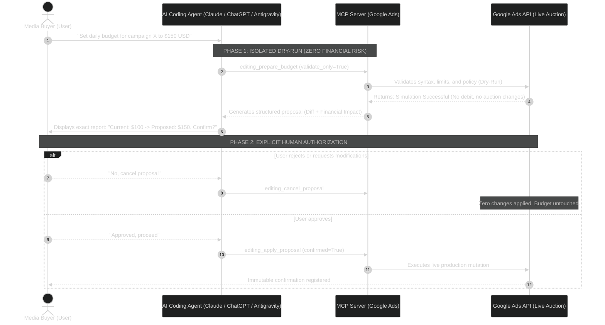
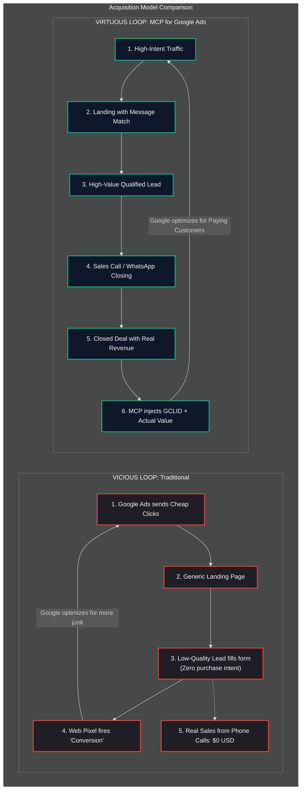
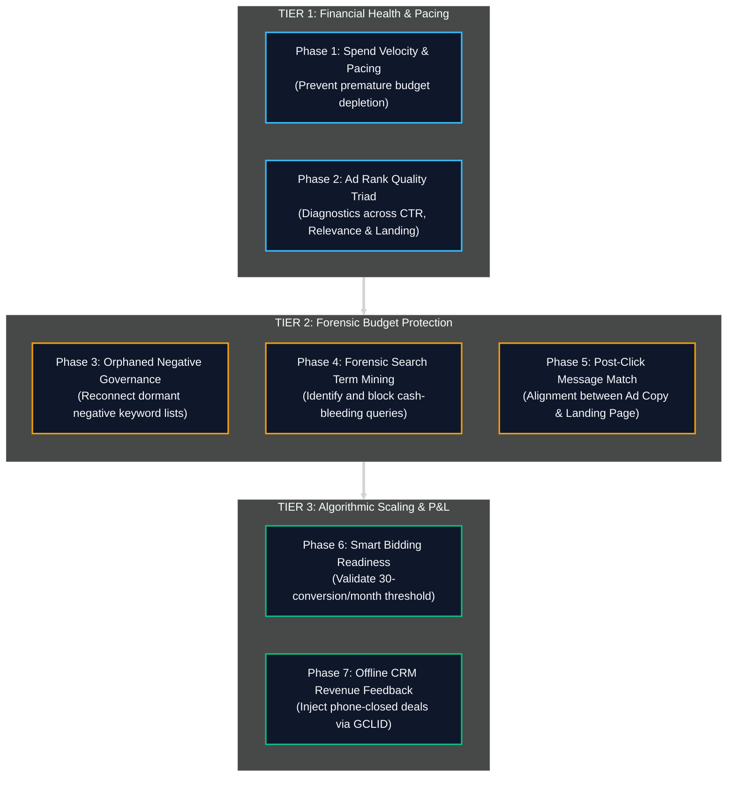

<div align="center">

**English** · [Español](README_es.md)

# MCP for Google Ads

### The Acquisition, Forensic Auditing & Unit Economics Operating System for Marketers and Media Buyers.

**Stop flying blind with passive AI tools that only read superficial metric tables. Audit, govern, scale, and defensively protect your Google Ads accounts at an executive level.**

[](https://www.python.org/)
[](https://modelcontextprotocol.io/)
[](#the-37-tool-advertising-intelligence-catalog)
[](LICENSE)
[-brightgreen?style=flat-square)]()

[Non-Technical Quick Start](#how-to-use-in-60-seconds-zero-coding) · [Two-Phase Safety](#your-credit-card-is-safe-two-phase-commit-security) · [The 4 Budget Bleeders](#the-four-silent-budget-bleeders-destroying-your-roas) · [Comparison](#why-mcp-for-google-ads) · [Legal Notice](#legal-notice-trademark--financial-liability-disclaimer)

</div>

> [!IMPORTANT]
> **Guaranteed Financial Safety:** Every mutation across campaigns, budgets, or ads strictly adheres to **Two-Phase Commit** (`validate_only=True` dry-runs in an isolated sandbox). No AI agent can mutate live spend or trigger real changes without your explicit in-chat authorization.

---

## How to Use in 60 Seconds (Zero Coding)

You don't need to write code, touch terminals, or manage local development environments. If you use **Claude Desktop**, **ChatGPT Desktop**, or **Antigravity**, simply register the server configuration and copy the master prompt.

### Step 1: Connect the Server to your AI Client
Open your AI application's configuration file (e.g., `claude_desktop_config.json` for Claude Desktop) and add this block inside `"mcpServers"`:

```json
{
  "mcpServers": {
    "google-ads": {
      "command": "uvx",
      "args": [
        "--from",
        "git+https://github.com/eddvasquez/mcp-for-google-ads",
        "mcp-for-google-ads"
      ],
      "env": {
        "GOOGLE_ADS_DEVELOPER_TOKEN": "your_developer_token",
        "GOOGLE_ADS_CLIENT_ID": "your_client_id",
        "GOOGLE_ADS_CLIENT_SECRET": "your_client_secret",
        "GOOGLE_ADS_REFRESH_TOKEN": "your_refresh_token"
      }
    }
  }
}
```

> [!TIP]
> **No manual installation needed:** `uvx` automatically downloads and boots the server directly from GitHub. If you cloned the repository locally, you can alternatively use `"command": "uv"` and `"args": ["--directory", "path/to/mcp-for-google-ads", "run", "mcp-for-google-ads"]`.

### Step 2: Copy & Paste this Master Prompt into your AI Chat

Start a conversation by pasting this exact prompt:

```text
Act as my World-Class Media Buyer & Senior Google Ads Consultant.

You have access to the 'mcp-for-google-ads' server (https://github.com/eddvasquez/mcp-for-google-ads).

We operate strictly under unit economics and high-performance acquisition standards:
1. NON-NEGOTIABLE RULE: Never apply live mutations (budgets, negatives, campaigns) without first performing a dry run using validate_only=True and presenting the detailed financial impact for my explicit authorization.
2. Begin by executing Phase 1: Financial Pacing & Account Health Audit on my account (Customer ID: [PASTE_YOUR_CUSTOMER_ID_HERE_WITHOUT_HYPHENS]).
3. Identify silent budget bleeders across search terms and verify if any orphaned shared negative lists exist before proposing bid modifications.
```

---

## Your Credit Card is Safe: Two-Phase Commit Security

The single biggest fear of a Media Buyer or business owner when connecting an AI to Google Ads is: *What happens if the model hallucinates, spikes bids, or blows through the monthly budget overnight?*

This system incorporates **Mandatory Transactional Safeguards**:

1. **Isolated Dry-Run Simulation (`validate_only=True`):** When the AI prepares an action (updating daily budgets, injecting keywords, or writing responsive search ads), Google Ads validates the payload in test mode. Zero funds are debited and the live auction remains untouched.
2. **Financial Impact Report:** The AI presents the exact proposed diff in chat, showing the projected P&L impact.
3. **Immutable Human Authorization:** Only when you reply with explicit confirmation does the system execute the change (`confirmed=True`).



---

## The Four Silent Budget Bleeders Destroying your ROAS

In high-stakes advertising, **more than 40% of spend is silently wasted** due to four structural blind spots:

### 1. The Search Term Cash Bleed
- **The Problem:** Even with high-intent keywords, Google's broad and phrase match algorithms trigger irrelevant search queries ("free", "jobs", "templates", "login").
- **The Solution:** Automated forensic mining that calculates the exact dollars wasted and compiles ready-to-publish negative keyword proposals in one click.

### 2. Orphaned (Dormant) Negative Lists
- **The Problem:** In most audited accounts, master lists with thousands of curated negative keywords exist but were never attached to newly created campaigns.
- **The Solution:** Governance auditing that flags disconnected lists (`reference_count == 0`) and instantly shields live campaigns.

### 3. Premature Smart Bidding
- **The Problem:** Enabling automated bidding (*Maximize Conversions* or *Target CPA*) in accounts with fewer than 30 conversions per month causes Google's algorithm to learn on statistical noise, driving CPAs through the roof.
- **The Solution:** Statistical readiness audits validating whether your account has sufficient volume for Smart Bidding or must remain under strategic manual control.

### 4. Algorithmic Poisoning
- **The Problem:** Google optimizes toward low-cost leads that submit spam form fills but never buy. The bidding algorithm receives dirty feedback and continues acquiring unqualified traffic.
- **The Solution:** Offline qualification uploads (GCLID injection) feeding verified revenue and phone-closed sales back into Google Ads to retrain the algorithm.



---

## Why MCP for Google Ads?

| Dimension | Basic Official Wrapper | MCP for Google Ads (Edd Vásquez) |
| :--- | :---: | :---: |
| **Available Tools** | 3 read-only queries | **37 enterprise-grade tools** |
| **Mutation Safety** | Read-only (no action) | **12 tools with Two-Phase Commit** (`validate_only=True`) |
| **Bleeder Mining** | Manual spreadsheet export | **Forensic waste detection with closed-loop negative proposals** |
| **List Governance** | None | **Audits orphaned negative sets and unshielded campaigns** |
| **Ad-to-Page Match** | Blind to destination URL | **Inspects Message Match (H1, H2, CTA vs. RSA Headlines)** |
| **Conversion Quality** | Web pixel events only | **CRM offline sales injection to cure Algorithmic Poisoning** |
| **Unit Economics** | No financial metrics | **Max Allowable CPA modeling based on ticket and close rates** |

---

## Architecture & 7-Phase Media Buyer Protocol



---

## The 37-Tool Advertising Intelligence Catalog

<details open>
<summary><b>1. Account Discovery & Structured GAQL Queries (3 Tools)</b></summary>

* `customers_list_accessible_customers`: Lists accessible customer account IDs for authenticated identities.
* `search_search`: Executes advanced queries using Google Ads Query Language (GAQL).
* `metadata_get_resource_metadata`: Discovers selectable fields, compatible metrics, and segments for any resource.
</details>

<details open>
<summary><b>2. Transactional Mutation Engine — Two-Phase Commit (12 Tools)</b></summary>

* `editing_prepare_campaign`: Modifies campaign budgets, statuses, and bidding strategies.
* `editing_prepare_ad_group`: Creates ad groups, manages statuses, and sets target CPA overrides.
* `editing_prepare_ad`: Builds and edits Responsive Search Ads (RSA) with headline validation.
* `editing_prepare_keywords`: Injects positive keywords, match types, and campaign-level negatives.
* `editing_prepare_budget`: Atomically updates daily account budgets.
* `editing_prepare_negative_list`: Creates, updates, and attaches shared negative keyword lists.
* `editing_list_negative_lists`: Lists all shared negative lists existing in the account.
* `editing_get_negative_list`: Inspects individual terms and attached campaigns within negative lists.
* `editing_apply_proposal`: Executes immutable production commits (`confirmed=True`).
* `editing_get_proposal`: Inspects structural diffs before execution (`validate_only=True`).
* `editing_cancel_proposal`: Discards and cancels unconfirmed proposals.
* `editing_reconcile_proposal`: Synchronizes and reconciles applied changes.
</details>

<details open>
<summary><b>3. Media Buying Intelligence, P&L & Unit Economics (22 Tools)</b></summary>

* `intelligence_audit_search_terms`: Forensic mining of cash-bleeding queries and quantified monetary waste.
* `intelligence_prepare_mined_negatives`: Converts bleeding queries directly into negative keyword proposals.
* `intelligence_analyze_impression_share`: Breaks down lost impression share by Budget vs. Ad Rank.
* `intelligence_audit_devices_and_geos`: Analyzes efficiency across devices (Mobile vs. Desktop) and locations.
* `intelligence_audit_budget_pacing`: Monitors spend velocity and end-of-month budget projections.
* `intelligence_check_account_health`: Detects disapproved ads, policy strikes, and billing blocks.
* `intelligence_audit_campaign_assets`: Evaluates asset coverage (sitelinks, callouts, price assets).
* `intelligence_audit_creative_fatigue`: Identifies creative fatigue and decaying CTR trends over 14-day rolling windows.
* `intelligence_audit_conversion_health`: Audits zero-conversion campaigns and conversion tracking health.
* `intelligence_audit_copy_persuasion`: Evaluates RSA copy against Pain, Unique Mechanism, and ICP Qualifiers.
* `intelligence_classify_intent_funnel`: Classifies search intent (Informational, Commercial, or Transactional).
* `intelligence_prepare_high_ticket_negative_shield`: Universal negative keyword shield across eight low-intent categories.
* `intelligence_audit_quality_score_triad`: Audits Quality Score (1-10), expected CTR, relevance, and landing page experience.
* `intelligence_audit_lead_dropoff`: Funnel leak analysis across Clicks -> Landing Page Sessions -> Qualified Leads (WhatsApp/Calls).
* `intelligence_calculate_high_ticket_unit_economics`: P&L modeling calculating Maximum Allowable CPA from target margins and sales close rates.
* `intelligence_audit_shared_negative_governance`: Detects orphaned negative lists (`reference_count == 0`) and unshielded campaigns.
* `intelligence_inspect_negative_list_terms`: Fast search and term inspection within large negative keyword lists.
* `intelligence_audit_bidding_strategy_readiness`: Evaluates 30-conversion/month thresholds to prevent premature Smart Bidding.
* `intelligence_audit_lead_to_sale_discrepancy`: Detects Algorithmic Poisoning by comparing CRM phone sales against reported Google conversions.
* `intelligence_audit_landing_page_message_match`: Inspects congruence between RSA ad headlines and landing page copy.
* `intelligence_upload_offline_conversion_call`: Injects qualified phone sales into Google Ads using GCLID identifiers.
* `intelligence_simulate_budget_scaling_elasticity`: Simulates CPA inflation elasticity under budget scale increments of 20% to 100%.
</details>

---

## Technical Developer Guide

<details>
<summary><b>Local Installation and Advanced CLI Configuration (Optional)</b></summary>

If you are a software engineer or developer building custom integrations:

### Local Installation via pip
```bash
git clone https://github.com/eddvasquez/mcp-for-google-ads.git
cd mcp-for-google-ads
pip install -e .
```

### TOML Configuration (OpenAI Codex CLI)
```toml
[mcp_servers.google_ads]
command = "uvx"
args = ["--from", "git+https://github.com/eddvasquez/mcp-for-google-ads", "mcp-for-google-ads"]

[mcp_servers.google_ads.env]
GOOGLE_ADS_DEVELOPER_TOKEN = "your_developer_token"
GOOGLE_ADS_CLIENT_ID = "your_client_id"
GOOGLE_ADS_CLIENT_SECRET = "your_client_secret"
GOOGLE_ADS_REFRESH_TOKEN = "your_refresh_token"
```
</details>

---

## Legal Notice, Trademark & Financial Liability Disclaimer

* **Author:** Edd Vásquez. All rights reserved.
* **License:** Distributed under [Apache License 2.0](LICENSE).
* **Trademark Disclaimer:** *Google Ads* is a registered trademark of Google LLC. *MCP for Google Ads* is an independent open-source project and is not affiliated with, endorsed by, sponsored by, or certified by Google LLC.
* **Financial & Advertising Liability Disclaimer:** This software interacts directly with live Google Ads accounts and billing APIs. It can query, modify, and mutate campaign budgets, bids, negative keyword sets, and statuses that generate real financial expenditures. Although strict safeguards are built-in (Two-Phase Commit with `validate_only=True`), the end user assumes sole and exclusive responsibility for auditing, verifying, and authorizing all budget and spending decisions. The author and contributors accept no liability whatsoever for financial losses, unexpected billing charges, account suspensions, or commercial outcomes resulting from the use of this software.
