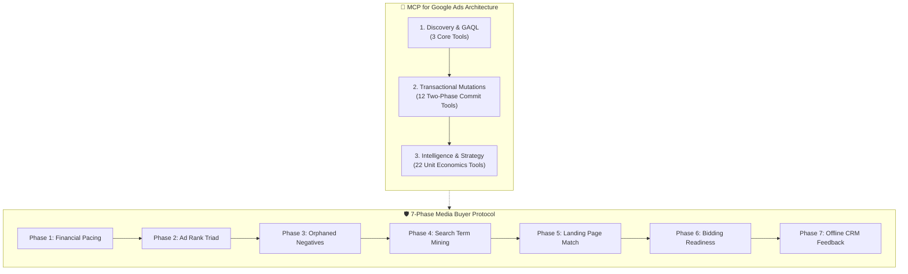
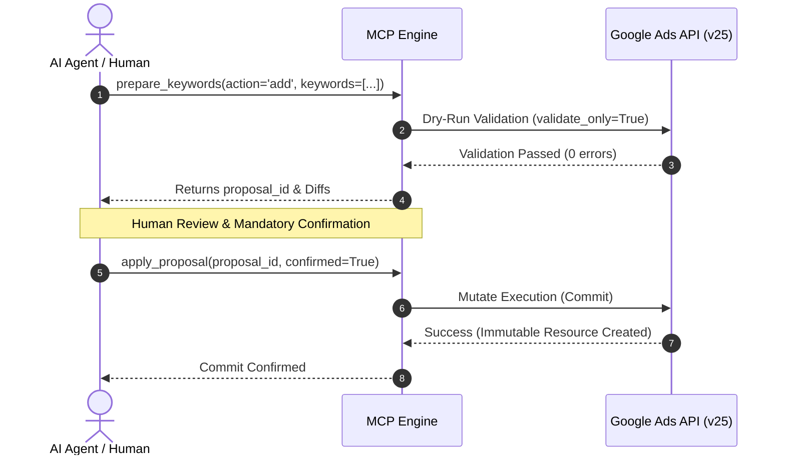

<div align="center">

**English** · [Español](README_es.md)

# MCP for Google Ads 🚀
### The World-Class Media Buyer & Unit Economics Operating System for AI Coding Agents.

**Stop flying blind with passive read-only API wrappers. Run, audit, scale, and defensively govern Google Ads at an enterprise level.**

[](https://www.python.org/)
[](https://modelcontextprotocol.io/)
[](#the-37-tool-operating-system)
[](LICENSE)
[-brightgreen?style=flat-square)]()

[Quick Start](#quick-start) · [Why MCP for Google Ads](#why-mcp-for-google-ads) · [The 37-Tool OS](#the-37-tool-operating-system) · [Two-Phase Safety](#two-phase-commit-safety) · [Client Setup](#client-configuration)

<code>pip install -e .</code>

</div>

> [!IMPORTANT]
> **Production Safety Guaranteed:** Every state mutation adheres to strict **Two-Phase Commit** (`validate_only=True` dry-runs before immutable commits). No AI agent can mutate live spend, budgets, or ad statuses without human-in-the-loop validation.

---

## 💡 Why MCP for Google Ads?

Most Google Ads AI tools are naive read-only wrappers that query basic campaign tables. In high-stakes acquisition, **85% of budget loss happens post-click or through silent auction bleeding**.

| Capability | Google Ads Official MCP | **MCP for Google Ads (Edd Vásquez)** |
| :--- | :---: | :---: |
| **Available Tools** | 3 tools | **37 enterprise-grade tools** |
| **Two-Phase Commit Mutations** | ❌ None (Read-only) | ✅ **12 atomic tools** (`validate_only=true`) |
| **Search Term Bleeder Mining** | ❌ Manual | ✅ **Closed-loop negative generator** |
| **Orphaned Negative Governance** | ❌ Missing | ✅ **Audits dormant sets (5,000+ terms)** |
| **Landing Page Message Match** | ❌ Blind | ✅ **Inspects H1/H2/CTA vs. RSA headlines** |
| **Offline CRM Qualification Upload** | ❌ No | ✅ **Feeds real revenue GCLIDs to cure Poisoning** |
| **Bidding Strategy Maturity Audit** | ❌ Blind | ✅ **Statistical 30-conversion threshold** |
| **High-Ticket Unit Economics Engine** | ❌ None | ✅ **Max Allowable CPA by ticket/close rate** |

---

## 🏗️ Architecture & Acquisition Engine



---

## 🛠️ The 37-Tool Operating System

<details open>
<summary><b>1. Account Discovery & Direct GAQL (3 Tools)</b></summary>

* `customers_list_accessible_customers`: Retrieve accessible Google Ads customer IDs.
* `search_search`: Structured Google Ads Query Language (GAQL) query execution.
* `metadata_get_resource_metadata`: Discover selectable fields, metrics, and segments for resources.
</details>

<details open>
<summary><b>2. Transactional Mutation Engine — Two-Phase Commit (12 Tools)</b></summary>

* `editing_prepare_campaign`: Budget, status, bidding strategy changes.
* `editing_prepare_ad_group`: Ad group creation, status, and target CPA overrides.
* `editing_prepare_ad`: Responsive Search Ad (RSA) creation with multi-headline/description validation.
* `editing_prepare_keywords`: Positive keywords, manual bids, match types, and campaign negatives.
* `editing_prepare_budget`: Daily campaign budget updates and delivery methods.
* `editing_prepare_negative_list`: Shared negative keyword list creation, renaming, adding terms, removing terms, and campaign attachment.
* `editing_list_negative_lists`: Query existing shared negative sets in the account.
* `editing_get_negative_list`: Detailed term-by-term and campaign link inspection.
* `editing_apply_proposal`: Immutable commit execution (`confirmed=True`).
* `editing_get_proposal`: Pre-execution diff inspection (`validate_only=True`).
* `editing_cancel_proposal`: Abort and discard draft proposal.
* `editing_reconcile_proposal`: Sync and reconcile executed changes.
</details>

<details open>
<summary><b>3. Media Buying Intelligence, Unit Economics & Funnel Strategy (22 Tools)</b></summary>

* `intelligence_audit_search_terms`: Mine bleeding search terms and quantify wasted spend.
* `intelligence_prepare_mined_negatives`: Convert wasted search queries directly into negative keyword proposals.
* `intelligence_analyze_impression_share`: Lost IS to Budget vs. Lost IS to Rank breakdown.
* `intelligence_audit_devices_and_geos`: Device bid modifier efficiency (Mobile vs. Desktop) and geo-targeting friction.
* `intelligence_audit_budget_pacing`: Month-to-date run rate and end-of-month budget projection.
* `intelligence_check_account_health`: Disapproved ads, billing issues, and account delivery status.
* `intelligence_audit_campaign_assets`: Sitelinks, callouts, structured snippets, and price extension coverage.
* `intelligence_audit_creative_fatigue`: CTR degradation detection over 14-day rolling windows.
* `intelligence_audit_conversion_health`: Zero-conversion campaigns and tracking health.
* `intelligence_audit_copy_persuasion`: Heuristic audit of RSA headlines against Pain, Unique Mechanism, Offer, and Repellent.
* `intelligence_classify_intent_funnel`: Informational vs. Commercial vs. Transactional intent classification.
* `intelligence_prepare_high_ticket_negative_shield`: 8-category universal repellent shield (free-seekers, jobs, students, DIY).
* `intelligence_audit_quality_score_triad`: Keyword-level Quality Score (1-10), Expected CTR, Ad Relevance, and Landing Page Experience.
* `intelligence_audit_lead_dropoff`: Ad Clicks -> Landing Page Visits -> Qualified Contacts (WhatsApp/Calls) conversion tracking.
* `intelligence_calculate_high_ticket_unit_economics`: P&L viability: Ticket Size, Gross Margin, and Closing Rate to determine Max Allowable CPA.
* `intelligence_audit_shared_negative_governance`: Identify orphaned negative lists (`reference_count == 0`) and unprotected active campaigns.
* `intelligence_inspect_negative_list_terms`: Fast search and filter within large negative keyword lists (2,000+ terms).
* `intelligence_audit_bidding_strategy_readiness`: Evaluate monthly conversion volume (30+ threshold) to prevent premature Smart Bidding swings.
* `intelligence_audit_lead_to_sale_discrepancy`: Detect *Algorithmic Poisoning* when Google conversions fail to convert to qualified CRM sales calls (<20% rate).
* `intelligence_audit_landing_page_message_match`: Scrapes and compares destination H1/H2/CTA against active RSA headlines to detect post-click friction.
* `intelligence_upload_offline_conversion_call`: Upload offline qualified calls/sales with GCLID and real revenue to cure Algorithmic Poisoning.
* `intelligence_simulate_budget_scaling_elasticity`: Models Lost IS (Budget vs. Rank) and CPC elasticity before scaling spend.
</details>

---

## 🛡️ Two-Phase Commit Safety

Unlike naive bots that write directly to production, **MCP for Google Ads** enforces a strict safety protocol:



---

## ⚡ Client Configuration

### Claude Desktop (`claude_desktop_config.json`)

```json
{
  "mcpServers": {
    "google-ads": {
      "command": "python",
      "args": ["-m", "ads_mcp.server"],
      "cwd": "/path/to/mcp-for-google-ads",
      "env": {
        "GOOGLE_APPLICATION_CREDENTIALS": "/path/to/credentials.json",
        "GOOGLE_CLOUD_PROJECT": "your-gcp-project-id"
      }
    }
  }
}
```

### OpenAI Codex CLI (`~/.codex/config.toml`)

```toml
[mcp_servers.google_ads]
startup_timeout_sec = 120
tool_timeout_sec = 120
command = "/path/to/venv/Scripts/google-ads-mcp-editing.exe"

[mcp_servers.google_ads.env]
GOOGLE_CLOUD_PROJECT = "your-gcp-project-id"
GOOGLE_APPLICATION_CREDENTIALS = "C:/path/to/credentials.json"
```

---

## 🔒 Legal Notice & Trademark Disclaimer

* **Author:** Edd Vásquez. All rights reserved.
* **Disclaimer:** *MCP for Google Ads* is an independent open-source project. It is **not** affiliated with, endorsed by, or sponsored by Google LLC. *Google Ads* is a registered trademark of Google LLC.
* **License:** Apache License 2.0. See [LICENSE](LICENSE) for details.
