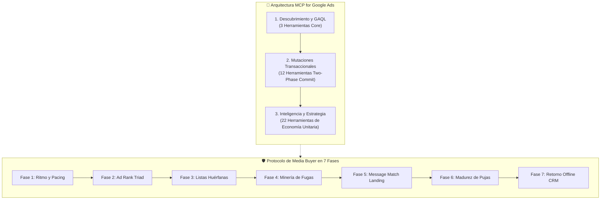
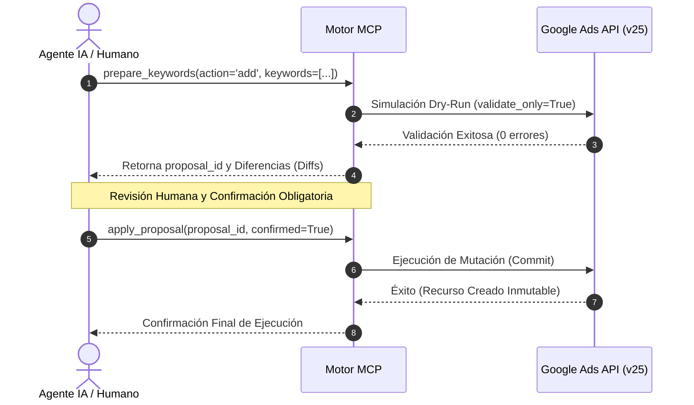

<div align="center">

[English](README.md) · **Español**

# MCP for Google Ads
### El Sistema Operativo de Adquisición, Media Buying y Economía Unitaria para Agentes de IA.

**Deja de operar a ciegas con wrappers de API pasivos y de solo lectura. Audita, gobierna, escala y protege tus cuentas de Google Ads a nivel de clase mundial.**

[](https://www.python.org/)
[](https://modelcontextprotocol.io/)
[](#el-sistema-operativo-de-37-herramientas)
[](LICENSE)
[-brightgreen?style=flat-square)]()

[Inicio Rápido](#inicio-rápido) · [Por Qué MCP for Google Ads](#por-qué-mcp-for-google-ads) · [El Catálogo de 37 Herramientas](#el-sistema-operativo-de-37-herramientas) · [Seguridad Two-Phase](#seguridad-two-phase-commit) · [Configuración](#configuración-del-cliente)

<code>pip install -e .</code>

</div>

> [!IMPORTANT]
> **Seguridad en Producción Garantizada:** Cada mutación publicitaria sigue el protocolo estricto de **Two-Phase Commit** (`validate_only=True` con simulación previa antes de confirmar cambios reales). Ningún agente de IA puede alterar presupuestos ni estados sin aprobación humana previa.

---

## Inicio Rápido

### Para Usuarios No Programadores (Copiar y Pegar en el Chat de tu IA)

Si no deseas manipular terminales ni entornos de desarrollo, copia y pega el siguiente bloque directamente en el chat de Claude Desktop, ChatGPT o Antigravity (una vez registrado el MCP en tu configuración):

```text
Actúa como mi Media Buyer de Clase Mundial y Consultor Senior de Adquisición en Google Ads.

Tienes a tu disposición el servidor 'mcp-for-google-ads' (https://github.com/eddvasquez/mcp-for-google-ads).

Quiero que operemos con rigor inquebrantable bajo el protocolo estricto de Two-Phase Commit:
1. Prohibido aplicar mutaciones en vivo (presupuestos, negativas, campañas) sin antes ejecutar una simulación previa con validate_only=True y presentarme el impacto proyectado para recibir mi aprobación expresa.
2. Inicia realizando la Fase 1: Auditoría de Pacing y Salud de Presupuesto en mi cuenta (Customer ID: [PEGA_AQUÍ_TU_CUSTOMER_ID_SIN_GUIONES]).
3. Identifica cualquier fuga de inversión o listas compartidas huérfanas antes de sugerir cambios de puja.
```

---

## Inicio Rápido para No Programadores (Copiar y Pegar en el Chat de tu IA)

Si no deseas utilizar la terminal ni gestionar entornos virtuales locales, copia y pega el siguiente bloque directamente en Claude Desktop, ChatGPT o Antigravity una vez registrado el servidor MCP:

\\	ext
Actúa como mi Media Buyer de Clase Mundial y Consultor Senior de Adquisición en Google Ads.

Tienes a tu disposición el servidor 'mcp-for-google-ads' (https://github.com/eddvasquez/mcp-for-google-ads).

Quiero que operemos con rigor inquebrantable bajo el protocolo estricto de Two-Phase Commit:
1. Prohibido aplicar mutaciones en vivo (presupuestos, negativas, campañas) sin antes ejecutar una simulación previa con validate_only=True y presentarme el impacto proyectado para recibir mi aprobación expresa.
2. Inicia realizando la Fase 1: Auditoría de Pacing y Salud de Presupuesto en mi cuenta (Customer ID: [PEGA_AQUÍ_TU_CUSTOMER_ID_SIN_GUIONES]).
3. Identifica cualquier fuga de inversión o listas compartidas huérfanas antes de sugerir cambios de puja.
\
---

## ¿Por Qué MCP for Google Ads?

La mayoría de herramientas de IA para Google Ads son lectores pasivos que consultan tablas básicas. En adquisición de alto rendimiento, **el 85% de las fugas de presupuesto ocurren post-clic o mediante sangrado silencioso en subastas**.

| Capacidad | Google Ads MCP Oficial | **MCP for Google Ads (Edd Vásquez)** |
| :--- | :---: | :---: |
| **Herramientas Disponibles** | 3 herramientas | **37 herramientas empresariales** |
| **Mutaciones en Dos Fases (Commit)** | ❌ Ninguna (Solo lectura) | ✅ **12 herramientas atómicas** (`validate_only=true`) |
| **Minería Forense de Search Terms** | ❌ Manual | ✅ **Generador de negativas en bucle cerrado** |
| **Gobernanza de Listas Huérfanas** | ❌ Inexistente | ✅ **Audita listas dormidas (5.000+ términos)** |
| **Message Match en Landing Page** | ❌ Ciego | ✅ **Compara H1/H2/CTA vs titulares del anuncio** |
| **Inyección de Conversiones Offline CRM**| ❌ No | ✅ **Envía GCLIDs reales para curar envenenamiento** |
| **Auditoría de Madurez de Puja** | ❌ Ciego | ✅ **Umbral estadístico de 30 conversiones/mes** |
| **Motor de Economía Unitaria High-Ticket**| ❌ Ninguno | ✅ **CPA Máximo Permitido por ticket y tasa de cierre** |

---

## Arquitectura y Flujo de Adquisición



---

## El Sistema Operativo de 37 Herramientas

<details open>
<summary><b>1. Descubrimiento de Cuentas y Consultas GAQL Directas (3 Herramientas)</b></summary>

* `customers_list_accessible_customers`: Recupera los IDs numéricos de clientes accesibles por la identidad autenticada.
* `search_search`: Ejecuta consultas estructuradas en Google Ads Query Language (GAQL).
* `metadata_get_resource_metadata`: Descubre campos seleccionables, métricas compatibles y segmentos para cualquier recurso.
</details>

<details open>
<summary><b>2. Motor Transaccional de Mutaciones — Two-Phase Commit (12 Herramientas)</b></summary>

* `editing_prepare_campaign`: Modificación de presupuestos, estados y estrategias de puja a nivel campaña.
* `editing_prepare_ad_group`: Creación de grupos de anuncios, estados y overrides de CPA objetivo.
* `editing_prepare_ad`: Creación de Responsive Search Ads (RSA) con validación estricta de múltiples titulares.
* `editing_prepare_keywords`: Inyección de palabras clave positivas, pujas manuales, concordancias y negativas de campaña.
* `editing_prepare_budget`: Actualización determinista de presupuestos diarios.
* `editing_prepare_negative_list`: Creación, renombrado, adición, retiro de términos y vinculación de listas compartidas.
* `editing_list_negative_lists`: Consulta de listas de negativas compartidas existentes en la cuenta.
* `editing_get_negative_list`: Inspección término por término y campañas vinculadas.
* `editing_apply_proposal`: Ejecución inmutable del commit (`confirmed=True`).
* `editing_get_proposal`: Inspección de diferencias (diffs) antes de la ejecución (`validate_only=True`).
* `editing_cancel_proposal`: Abortar y descartar propuestas pendientes.
* `editing_reconcile_proposal`: Conciliación y sincronización de cambios ejecutados.
</details>

<details open>
<summary><b>3. Inteligencia de Compra de Medios, Economía Unitaria y Embudos (22 Herramientas)</b></summary>

* `intelligence_audit_search_terms`: Minería forense de términos de búsqueda sangrantes y cuantificación del desperdicio.
* `intelligence_prepare_mined_negatives`: Convierte consultas irrelevantes directamente en propuestas de negativas.
* `intelligence_analyze_impression_share`: Desglose de cuota perdida por Presupuesto vs. Ad Rank.
* `intelligence_audit_devices_and_geos`: Eficiencia por dispositivo (Móvil vs. Desktop) y fricción geográfica.
* `intelligence_audit_budget_pacing`: Tasa de gasto mensual y proyección presupuestaria a fin de mes.
* `intelligence_check_account_health`: Auditoría de anuncios desaprobados y problemas de facturación.
* `intelligence_audit_campaign_assets`: Cobertura de enlaces de sitio, textos destacados y extensiones de precio.
* `intelligence_audit_creative_fatigue`: Detección de fatiga y degradación del CTR en ventanas de 14 días.
* `intelligence_audit_conversion_health`: Campañas con cero conversiones y salud del tracking.
* `intelligence_audit_copy_persuasion`: Auditoría heurística de titulares RSA contra Dolor, Mecanismo Único y Repelente.
* `intelligence_classify_intent_funnel`: Clasificación de intención Informativa vs. Comercial vs. Transaccional.
* `intelligence_prepare_high_ticket_negative_shield`: Escudo universal repelente de 8 categorías (busca-gratis, empleo, DIY).
* `intelligence_audit_quality_score_triad`: Calidad por keyword (1-10), CTR esperado, relevancia y experiencia post-clic.
* `intelligence_audit_lead_dropoff`: Fricción en el embudo Clics -> Visitas Landing -> Contactos Calificados (WhatsApp/Llamadas).
* `intelligence_calculate_high_ticket_unit_economics`: P&L: Cálculo del CPA Máximo Permitido por ticket y tasa de cierre.
* `intelligence_audit_shared_negative_governance`: Identifica listas huérfanas (`reference_count == 0`) y campañas desprotegidas.
* `intelligence_inspect_negative_list_terms`: Búsqueda y filtrado rápido dentro de listas masivas (2.000+ términos).
* `intelligence_audit_bidding_strategy_readiness`: Evalúa el umbral de 30 conversiones/mes para evitar Smart Bidding prematuro.
* `intelligence_audit_lead_to_sale_discrepancy`: Detecta *Algorithmic Poisoning* cuando los leads no califican en el CRM (<20%).
* `intelligence_audit_landing_page_message_match`: Extrae y compara H1/H2/CTA de la landing contra los anuncios RSA.
* `intelligence_upload_offline_conversion_call`: Inyección de conversiones offline (GCLID) con ingresos reales para educar al algoritmo.
* `intelligence_simulate_budget_scaling_elasticity`: Modela cuota perdida y elasticidad del CPC antes de aumentar presupuestos.
</details>

---

## Seguridad Two-Phase Commit

A diferencia de bots novatos que ejecutan mutaciones directamente en producción, **MCP for Google Ads** exige un ciclo de confirmación inmutable:



---

## Configuración del Cliente

### Claude Desktop (`claude_desktop_config.json`)

```json
{
  "mcpServers": {
    "google-ads": {
      "command": "python",
      "args": ["-m", "ads_mcp.server"],
      "cwd": "/ruta/a/mcp-for-google-ads",
      "env": {
        "GOOGLE_APPLICATION_CREDENTIALS": "/ruta/a/credenciales.json",
        "GOOGLE_CLOUD_PROJECT": "tu-proyecto-gcp"
      }
    }
  }
}
```

### OpenAI Codex CLI (`~/.codex/config.toml`)

```toml
[mcp_servers.google_ads]
startup_timeout_sec = 120
tool_timeout_sec = 120
command = "/ruta/a/venv/Scripts/google-ads-mcp-editing.exe"

[mcp_servers.google_ads.env]
GOOGLE_CLOUD_PROJECT = "tu-proyecto-gcp"
GOOGLE_APPLICATION_CREDENTIALS = "C:/ruta/a/credenciales.json"
```

---

## Aviso Legal, Marcas Registradas y Deslinde de Responsabilidad Financiera

* **Autor:** Edd Vásquez. Todos los derechos reservados.
* **Licencia:** Distribuido bajo [Apache License 2.0](LICENSE).
* **Marcas Registradas:** *Google Ads* es una marca registrada de Google LLC. *MCP for Google Ads* es un proyecto independiente de código abierto y no está afiliado, respaldado, patrocinado ni certificado por Google LLC.
* **Descargo de Responsabilidad Publicitaria y Financiera:** Este software interactúa directamente con la API de Google Ads y puede consultar o modificar presupuestos, pujas, estados de campañas y términos de búsqueda que conllevan gastos económicos reales en cuentas publicitarias. Aunque el sistema implementa protocolos de seguridad (Two-Phase Commit con \alidate_only=True\), el usuario final es el único y exclusivo responsable de auditar, verificar y autorizar cualquier cambio de gasto o estado en sus cuentas. El autor y los colaboradores no asumen responsabilidad alguna por pérdidas financieras, cargos en tarjetas de crédito, suspensiones de cuentas publicitarias o rendimientos comerciales derivados del uso de este software.

---

### Recuperación del ejecutor diario de palabras clave

La skill central google-ads-palabras-clave-nuevas consume las funciones locales del
mismo backend que exponen las herramientas MCP. No hay un segundo transporte MCP
ni lógica publicitaria duplicada. El modelo aporta selección comercial; el motor
mantenido ejecuta publish/resume/reconcile y conserva SQLite local fuera de Git.

El preflight distingue EXPIRED, PREFLIGHT_RETRYABLE (NOT_SENT) y REJECTED. Solo las
lecturas y validate_only temporales admiten tres intentos con espera exponencial.
La mutación real nunca se reintenta automáticamente; UNKNOWN/APPLYING/UNVERIFIED
requieren reconciliación en lectura. Los estados previos siguen siendo compatibles.

El cliente puede conservar consentimiento para un contrato exacto de operaciones
si solo renueva IDs técnicos y demuestra contenido idéntico, ausencia de envío
incierto y validación vigente. No equivale a aprobación automática: palabras,
destinos, concordancias, estados y activación distintos requieren consentimiento.
