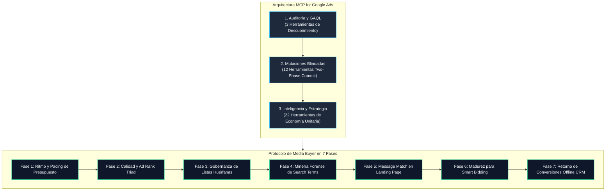

<div align="center">

[English](README.md) · **Español**

# MCP for Google Ads

### El Sistema de Adquisición, Auditoría Forense y Economía Unitaria para Marketers y Media Buyers.

**Deja de operar a ciegas con herramientas de IA pasivas que solo leen tablas superficiales. Audita, gobierna, escala y protege tus cuentas de Google Ads bajo estándares de alta dirección.**

[](https://www.python.org/)
[](https://modelcontextprotocol.io/)
[](#el-catalogo-de-37-herramientas-de-inteligencia-publicitaria)
[](LICENSE)
[-brightgreen?style=flat-square)]()

[Cómo Usarlo Sin Programar](#como-usar-este-sistema-en-60-segundos-sin-programar) · [Tarjeta Blindada](#tu-tarjeta-de-credito-esta-a-salvo-seguridad-two-phase-commit) · [Las 4 Fugas de Capital](#las-cuatro-fugas-silenciosas-que-destruyen-tu-rentabilidad) · [Comparativa](#por-que-mcp-for-google-ads) · [Aviso Legal](#aviso-legal-marcas-registradas-y-deslinde-de-responsabilidad-financiera)

</div>

> [!IMPORTANT]
> **Seguridad Financiera Garantizada:** Cada modificación sobre campañas, presupuestos o anuncios sigue el protocolo estricto de **Two-Phase Commit** (`validate_only=True` con simulación previa en un entorno aislado). Ningún agente de Inteligencia Artificial puede alterar tu inversión ni activar cambios reales sin tu confirmación expresa en el chat.

---

## Cómo Usar este Sistema en 60 Segundos (Sin Programar)

No necesitas escribir código, manipular terminales ni gestionar entornos de desarrollo. Si ya utilizas **Claude Desktop**, **ChatGPT Desktop** o **Antigravity**, solo debes conectar el servidor y copiar un prompt maestro.

### Paso 1: Conecta el Servidor en tu Aplicación de IA
Abre el archivo de configuración de tu aplicación (por ejemplo, `claude_desktop_config.json` en Claude Desktop) y agrega este bloque dentro de `"mcpServers"`:

```json
{
  "mcpServers": {
    "google-ads": {
      "command": "uvx",
      "args": ["mcp-for-google-ads"],
      "env": {
        "GOOGLE_ADS_DEVELOPER_TOKEN": "tu_developer_token",
        "GOOGLE_ADS_CLIENT_ID": "tu_client_id",
        "GOOGLE_ADS_CLIENT_SECRET": "tu_client_secret",
        "GOOGLE_ADS_REFRESH_TOKEN": "tu_refresh_token"
      }
    }
  }
}
```

### Paso 2: Copia y Pega Este Prompt en la Ventana de Chat de tu IA

Inicia una conversación pegando exactamente este texto:

```text
Actúa como mi Media Buyer de Clase Mundial y Consultor Senior de Adquisición en Google Ads.

Tienes a tu disposición el servidor 'mcp-for-google-ads' (https://github.com/eddvasquez/mcp-for-google-ads).

Quiero que auditemos mi cuenta bajo estrictos criterios de rentabilidad y economía unitaria:
1. REGLA INQUEBRANTABLE: Prohibido aplicar cualquier cambio en vivo (presupuestos, negativas, campañas) sin antes ejecutar una simulación previa con validate_only=True y mostrarme la propuesta detallada para recibir mi aprobación expresa.
2. Inicia realizando la Fase 1: Auditoría de Pacing y Salud de Presupuesto en mi cuenta (Customer ID: [PEGA_AQUÍ_TU_CUSTOMER_ID_SIN_GUIONES]).
3. Identifica cualquier fuga de presupuesto en términos de búsqueda y revisa si existen listas de negativas huérfanas antes de sugerir cambios de puja.
```

---

## Tu Tarjeta de Crédito Está a Salvo: Seguridad Two-Phase Commit

El mayor temor de un Media Buyer o dueño de negocio al conectar una IA a Google Ads es: *¿Qué ocurre si el modelo comete un error, dispara las pujas o consume el presupuesto en una noche?*

Este sistema incorpora **Blindaje Transaccional Obligatorio**:

1. **Simulación Previa Aislada (`validate_only=True`):** Cuando la IA formula una propuesta (ajustar presupuestos diarios, inyectar palabras clave o crear anuncios responsivos), el cambio se envía a Google Ads en modo prueba. No se debita dinero ni se altera la subasta real.
2. **Reporte de Impacto Financiero:** La IA te presenta en el chat la propuesta exacta, el impacto proyectado en tu P&L y el cambio de estado.
3. **Confirmación Humana Inmutable:** Solo cuando respondes positivamente, el sistema envía la confirmación final (`confirmed=True`).

---

## Las Cuatro Fugas Silenciosas que Destruyen tu Rentabilidad

En adquisición de alto rendimiento, **más del 40% del presupuesto publicitario se desperdicia silenciosamente** por cuatro fallas estructurales:

### 1. El Sangrado de Términos de Búsqueda Irrelevantes
- **El Problema:** Aunque tus palabras clave sean de alta intención comercial, las concordancias amplia y de frase de Google activan búsquedas no deseadas ("gratis", "empleo", "tutorial", "login").
- **La Solución:** Minería forense automatizada que calcula los fondos exactos desperdiciados y prepara propuestas de negativas en un solo clic.

### 2. Las Listas de Negativas Huérfanas (Dormidas)
- **El Problema:** En gran parte de las cuentas auditadas, existen listas con miles de negativas acumuladas que nunca fueron vinculadas a las campañas nuevas.
- **La Solución:** Auditoría de gobernanza que identifica listas desconectadas (`reference_count == 0`) y protege tus campañas activas de inmediato.

### 3. El Smart Bidding Prematuro
- **El Problema:** Activar estrategias de puja automática (*Maximizar Conversiones* o *Target CPA*) en cuentas con menos de 30 conversiones al mes provoca que el algoritmo aprenda con datos insuficientes, disparando el costo por adquisición.
- **La Solución:** Auditoría de madurez estadística que valida si tu cuenta cuenta con volumen suficiente o si debe operar bajo control manual estratégico.

### 4. El Envenenamiento Algorítmico (*Algorithmic Poisoning*)
- **El Problema:** Google optimiza hacia leads baratos que llenan formularios superficiales pero nunca compran. El algoritmo recibe retroalimentación de baja calidad y atrae prospectos no calificados.
- **La Solución:** Inyección de conversiones offline calificadas (GCLID) con los datos reales de ventas cerradas por tu equipo comercial o llamadas de WhatsApp.

---

## ¿Por Qué MCP for Google Ads?

| Dimensión | Conector Oficial Básico | MCP for Google Ads (Edd Vásquez) |
| :--- | :---: | :---: |
| **Herramientas Disponibles** | 3 herramientas de lectura | **37 herramientas empresariales** |
| **Seguridad de Cambios** | Solo lectura (sin acción) | **12 herramientas con Two-Phase Commit** (`validate_only=True`) |
| **Minería de Fugas** | Manual en hojas de cálculo | **Detección forense de desperdicio con generación de negativas** |
| **Gobernanza de Listas** | Inexistente | **Audita listas huérfanas y campañas desprotegidas** |
| **Coherencia Anuncio-Landing** | Ciego ante la web de destino | **Inspecciona Message Match (H1, H2, CTA vs. Anuncios)** |
| **Calidad de Conversión** | Solo eventos del píxel web | **Inyección de ventas offline desde CRM para curar el algoritmo** |
| **Economía Unitaria** | Ninguna métrica de negocio | **Cálculo del CPA Máximo Permitido por ticket y tasa de cierre** |

---

## Arquitectura y Protocolo de Adquisición en Siete Fases



---

## El Catálogo de 37 Herramientas de Inteligencia Publicitaria

<details open>
<summary><b>1. Descubrimiento de Cuentas y Consultas Estructuradas (3 Herramientas)</b></summary>

* `customers_list_accessible_customers`: Recupera los IDs de las cuentas accesibles por la identidad autenticada.
* `search_search`: Ejecuta consultas avanzadas en Google Ads Query Language (GAQL).
* `metadata_get_resource_metadata`: Descubre campos seleccionables, métricas compatibles y segmentos para cualquier recurso publicitario.
</details>

<details open>
<summary><b>2. Motor Transaccional de Mutaciones — Two-Phase Commit (12 Herramientas)</b></summary>

* `editing_prepare_campaign`: Modificación de presupuestos, estados y estrategias de puja a nivel campaña.
* `editing_prepare_ad_group`: Creación de grupos de anuncios, estados y ajustes de CPA objetivo.
* `editing_prepare_ad`: Creación y ajuste de Responsive Search Ads (RSA) con validación estricta de titulares.
* `editing_prepare_keywords`: Inyección de palabras clave, concordancias y negativas a nivel campaña.
* `editing_prepare_budget`: Actualización determinista de presupuestos diarios.
* `editing_prepare_negative_list`: Creación, edición y vinculación de listas compartidas de negativas.
* `editing_list_negative_lists`: Consulta de listas compartidas existentes en la cuenta.
* `editing_get_negative_list`: Inspección término por término y campañas asociadas.
* `editing_apply_proposal`: Ejecución inmutable del cambio (`confirmed=True`).
* `editing_get_proposal`: Inspección de diferencias (diffs) antes de la ejecución (`validate_only=True`).
* `editing_cancel_proposal`: Descarte y anulación de propuestas pendientes.
* `editing_reconcile_proposal`: Conciliación y sincronización de cambios ejecutados.
</details>

<details open>
<summary><b>3. Inteligencia de Compra de Medios, P&L y Embudos (22 Herramientas)</b></summary>

* `intelligence_audit_search_terms`: Minería forense de términos de búsqueda sangrantes y cuantificación del desperdicio monetario.
* `intelligence_prepare_mined_negatives`: Convierte consultas irrelevantes directamente en propuestas de negativas.
* `intelligence_analyze_impression_share`: Desglose de cuota de impresiones perdida por Presupuesto vs. Ranking.
* `intelligence_audit_devices_and_geos`: Eficiencia comparativa por dispositivo (Móvil vs. Desktop) y fricción geográfica.
* `intelligence_audit_budget_pacing`: Tasa de gasto mensual y proyección estimada a fin de mes.
* `intelligence_check_account_health`: Detección inmediata de anuncios rechazados y problemas de facturación.
* `intelligence_audit_campaign_assets`: Cobertura de extensiones (sitelinks, textos destacados, precios).
* `intelligence_audit_creative_fatigue`: Detección de fatiga creativa y caída de CTR en ventanas de 14 días.
* `intelligence_audit_conversion_health`: Campañas con cero conversiones e integridad del tracking.
* `intelligence_audit_copy_persuasion`: Evaluación de titulares RSA contra Dolor, Mecanismo Único y Elementos de Calificación.
* `intelligence_classify_intent_funnel`: Clasificación de consultas según intención (Informativa, Comercial o Transaccional).
* `intelligence_prepare_high_ticket_negative_shield`: Escudo universal repelente de ocho categorías (buscadores de empleo, contenido gratuito, etc.).
* `intelligence_audit_quality_score_triad`: Nivel de calidad por palabra clave (1-10), CTR esperado, relevancia y experiencia post-clic.
* `intelligence_audit_lead_dropoff`: Análisis de fricción en el embudo Clics -> Visitas Landing -> Contactos Calificados (WhatsApp/Llamadas).
* `intelligence_calculate_high_ticket_unit_economics`: P&L: Cálculo del CPA Máximo Permitido según ticket promedio y tasa de cierre de ventas.
* `intelligence_audit_shared_negative_governance`: Identificación de listas huérfanas (`reference_count == 0`) y campañas sin protección.
* `intelligence_inspect_negative_list_terms`: Búsqueda y filtrado dentro de listas masivas de negativas.
* `intelligence_audit_bidding_strategy_readiness`: Evaluación del umbral de 30 conversiones/mes para prevenir Smart Bidding prematuro.
* `intelligence_audit_lead_to_sale_discrepancy`: Detección de envenenamiento algorítmico comparando registros de CRM vs. conversiones reportadas por Google.
* `intelligence_audit_landing_page_message_match`: Inspección de coherencia entre los titulares del anuncio y la promesa principal de la página de destino.
* `intelligence_upload_offline_conversion_call`: Inyección de llamadas calificadas y ventas reales mediante identificador GCLID.
* `intelligence_simulate_budget_scaling_elasticity`: Simulación de elasticidad para proyectar el incremento de CPA ante aumentos de presupuesto del 20% al 100%.
</details>

---

## Guía Técnica para Desarrolladores

<details>
<summary><b>Instalación Local y Configuración Avanzada (Opcional)</b></summary>

Si eres ingeniero de software o desarrollador y prefieres compilar el proyecto localmente:

### Instalación vía pip
```bash
git clone https://github.com/eddvasquez/mcp-for-google-ads.git
cd mcp-for-google-ads
pip install -e .
```

### Configuración en TOML (OpenAI Codex CLI)
```toml
[mcp_servers.google_ads]
command = "uvx"
args = ["mcp-for-google-ads"]

[mcp_servers.google_ads.env]
GOOGLE_ADS_DEVELOPER_TOKEN = "tu_developer_token"
GOOGLE_ADS_CLIENT_ID = "tu_client_id"
GOOGLE_ADS_CLIENT_SECRET = "tu_client_secret"
GOOGLE_ADS_REFRESH_TOKEN = "tu_refresh_token"
```
</details>

---

## Aviso Legal, Marcas Registradas y Deslinde de Responsabilidad Financiera

* **Autor:** Edd Vásquez. Todos los derechos reservados.
* **Licencia:** Distribuido bajo [Apache License 2.0](LICENSE).
* **Marcas Registradas:** *Google Ads* es una marca registrada de Google LLC. *MCP for Google Ads* es un proyecto independiente de código abierto y no está afiliado, respaldado, patrocinado ni certificado por Google LLC.
* **Descargo de Responsabilidad Publicitaria y Financiera:** Este software interactúa directamente con la API de Google Ads y puede consultar o modificar presupuestos, pujas, estados de campañas y términos de búsqueda que conllevan gastos económicos reales en cuentas publicitarias. Aunque el sistema implementa protocolos de seguridad (Two-Phase Commit con `validate_only=True`), el usuario final es el único y exclusivo responsable de auditar, verificar y autorizar cualquier cambio de gasto o estado en sus cuentas. El autor y los colaboradores no asumen responsabilidad alguna por pérdidas financieras, cargos en tarjetas de crédito, suspensiones de cuentas publicitarias o rendimientos comerciales derivados del uso de este software.
