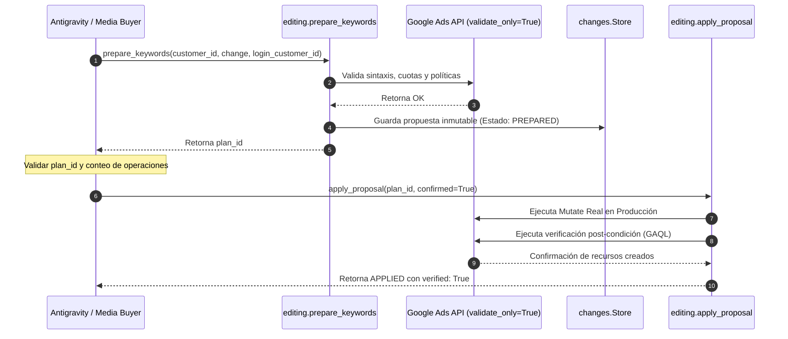

# Cheatsheet Técnico: Servidor Google Ads MCP Extended

**Repositorio Canónico:** [`eddvasquez/google-ads-mcp-extended`](https://github.com/eddvasquez/google-ads-mcp-extended)  
**Módulos Principales:**
- `ads_mcp.tools.editing`: Mutaciones programáticas bajo Two-Phase Commit.
- `ads_mcp.tools.search`: Consultas analíticas y reportes estructurados sobre Google Ads API.
- `ads_mcp.extensions.search`: Modelos Pydantic para preparación de propuestas (`search.Keywords`, etc.).

---

## 1. Protocolo Obligatorio Two-Phase Commit

Queda terminantemente prohibido ejecutar mutaciones ciegas. Todo cambio a nivel de palabras clave, presupuestos o estados sigue la secuencia:



---

## 2. Inyección de Palabras Clave Positivas (Two-Step Lifecycle)

### Paso 1: Agregar Criterios (Quedan en `PAUSED`)
```python
from ads_mcp.tools import editing
from ads_mcp.extensions import search

change = search.Keywords(
    action="add",
    ad_group_id="195980796410",
    keywords=[
        {"text": "amarres de amor efectivos", "match_type": "PHRASE"},
        {"text": "amarres de amor efectivos", "match_type": "EXACT"}
    ]
)
prep = editing.prepare_keywords(customer_id="8176867605", change=change, login_customer_id="5081959625")
plan_id = prep.get("plan_id")
app = editing.apply_proposal(plan_id=plan_id, confirmed=True)
```

> [!CAUTION]
> **No pasar `status` en `action="add"`**: La API de Google Ads rechaza la llamada si se intenta forzar `status="ENABLED"` durante la creación. Los criterios se crean por defecto en `PAUSED`.

### Paso 2: Habilitar Criterios Creados (`status="ENABLED"`)
```python
# Extraer IDs de criterios creados desde el proposal store
prop = editing.get_proposal(plan_id)
resource_names = prop.get("result", {}).get("resource_names", [])
criterion_ids = [rn.split("~")[-1] for rn in resource_names if "~" in rn]

enable_change = search.Keywords(
    action="status",
    ad_group_id="195980796410",
    criterion_ids=criterion_ids,
    status="ENABLED"
)
prep_en = editing.prepare_keywords(customer_id="8176867605", change=enable_change, login_customer_id="5081959625")
app_en = editing.apply_proposal(plan_id=prep_en.get("plan_id"), confirmed=True)
```

---

## 3. Inyección de Negativas a Nivel de Campaña

Para blindar perimetralmente campañas contra fugas detectadas:
```python
change = search.Keywords(
    action="add_negatives",
    campaign_id="24300670467",
    keywords=[
        {"text": "gratis", "match_type": "PHRASE"},
        {"text": "empleo", "match_type": "PHRASE"},
        {"text": "pdf", "match_type": "PHRASE"}
    ]
)
prep = editing.prepare_keywords(customer_id="8176867605", change=change, login_customer_id="5081959625")
app = editing.apply_proposal(plan_id=prep.get("plan_id"), confirmed=True)
# Las negativas de campaña se activan de inmediato sin requerir segundo paso.
```

---

## 4. Regla Sintáctica de la API: Límite de 10 Palabras

* **Restricción:** Google Ads API rechaza cualquier palabra clave positiva con más de **10 palabras**.
* **Error emitido:** `criterion_error: KEYWORD_HAS_TOO_MANY_WORDS`.
* **Solución mandatoria:** Condensar previamente el texto antes de invocar `prepare_keywords`.
  - *Incorrecto (11 palabras):* `"como hacer que alguien piense en ti y te busque ritual"` $\rightarrow$ Error.
  - *Correcto (10 palabras):* `"como hacer que alguien piense en ti y te busque"` $\rightarrow$ `GOOGLE_VALIDATED`.

---

## 5. Consultas Analíticas (Read-Only)

```python
from ads_mcp.tools import search as s_tool

results = s_tool.search(
    customer_id="8176867605",
    resource="ad_group_criterion",
    fields=["ad_group_criterion.keyword.text", "ad_group_criterion.status"],
    conditions=[
        "ad_group.id = 195980796410",
        "ad_group_criterion.type = 'KEYWORD'",
        "ad_group_criterion.negative = FALSE"
    ],
    login_customer_id="5081959625"
)
```
