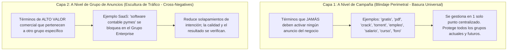
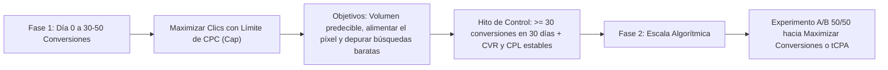
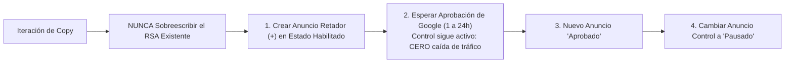
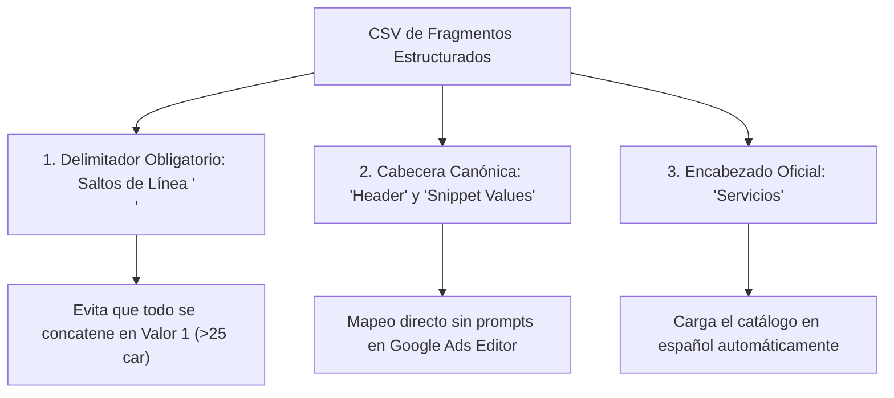
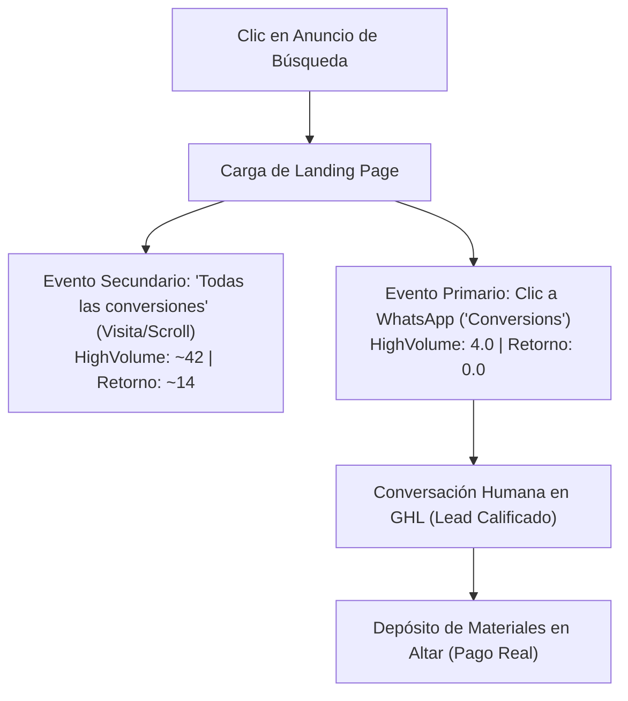
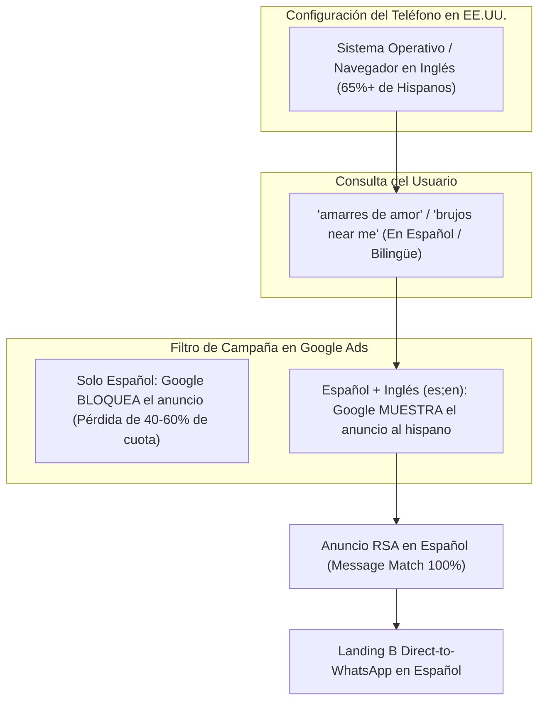
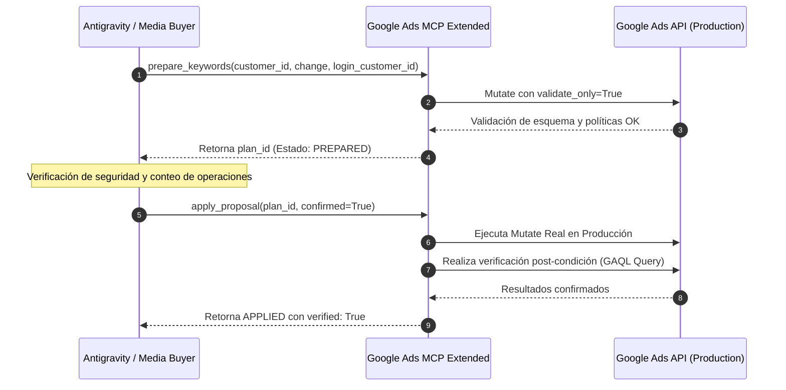

# SOP: Buenas Prácticas, Arquitectura y Gobernanza de Google Ads

## Directriz vigente: arquitectura consolidada sin sufijos

Los únicos nombres canónicos de estructura son `Search_USA_Retorno_DirectResponse` y `Search_USA_HighVolume_Amr`. Cualquier sufijo en un informe se normaliza al nombre base para el análisis. Los informes Pablo-P2b y Pablo-P3D son fuentes conjuntas de evidencia; no generan arquitecturas, listas ni recomendaciones diferenciadas.

Las listas se deduplican por campaña, grupo, texto y concordancia. Se conserva la procedencia en los informes originales. La consolidación documental no implica renombrar campañas publicadas ni modificar los informes.

### Reglas de selección y revisión

Las consultas claramente ajenas al servicio se excluyen; las ambiguas se observan. No excluir dolor sentimental, terceras personas o comprobación de confianza por contener una palabra aislada. Revisar que las negativas de campaña y grupo no bloqueen positivas; una negativa cruzada debe reservar la intención a su destino, no excluirla de ambas campañas.

Las positivas nuevas son hipótesis: comenzar con alcance controlado y coherencia entre búsqueda, anuncio y página. La lista común y la específica de campaña se sincronizan desde `docs/google_ads_search_campaign_amr.md` y las dos plantillas. Los conteos se calculan desde criterios únicos, nunca desde repeticiones del texto.

Referencia de concordancias: [Google Ads](https://support.google.com/google-ads/answer/2453972?hl=es).


**Documento Operativo de Trinchera para la Gestión y Escala de Campañas en Red de Búsqueda**  
**Versión:** 2.0 (Documento Vivo)  
**Nivel de Madurez:** Clase Mundial (Estándar de Agencia de Respuesta Directa)  
**Ámbito de Aplicación:** Cuentas de Google Ads, Google Ads Editor, Google Ads MCP Extended, Google Keyword Planner y Gobernanza de Tracking  

---

## 📋 Control de Versiones y Mantenimiento

Este documento es una fuente de verdad (*Single Source of Truth*) para la planificación, despliegue, optimización y resolución de contingencias en Google Ads. Se actualiza cada vez que se valide una nueva regla o patrón operativo en el proyecto.

| Versión | Fecha | Autor / Rol | Resumen de Cambios |
| :--- | :--- | :--- | :--- |
| **v1.0** | 30/09/2026 | Media Buyer Senior | Creación inicial consolidando las 9 prácticas maestras: arquitectura de negativas en dos capas, divisa nominal en Editor, bidding en dos tiempos, percentil 60-70%, geolocalización estricta, concordancias de negativas, RSAs con pines, concentración 70/30 y trazabilidad GCLID. |
| **v1.1** | 02/10/2026 | Codex | Consultas mixtas con destino conservado, siete exclusiones específicas de HighVolume, sustitución de negativas de método por exactas y corrección de afirmaciones de autopuja, derivación y calidad garantizadas. |
| **v1.2** | 03/10/2026 | Media Buyer Senior | Gobernanza de dispositivos móviles 100% (-100% desktop/tablets) y protocolo de cadencia y criterios estadísticos para auditoría de términos de búsqueda (Criterio Bleeder y Criterio Unicornio). |
| **v1.3** | 10/10/2026 | Media Buyer Senior | Gobernanza de fragmentos estructurados (delimitador `\n` vs punto y coma, cabecera canónica `Structured snippet header` e idioma obligatorio) y protocolo de arquitectura dual Control vs. Retador para RSAs y recursos. |
| **v1.4** | 12/10/2026 | Media Buyer Senior | Gobernanza de informes de términos de búsqueda (51 cols en Editor vs 15 en Web UI), aislamiento estricto de 'Todas las conversiones' (All conv) frente a primarias de WhatsApp, y blindaje de 16 nuevos criterios negativos comunes. |
| **v1.5** | 12/10/2026 | Media Buyer Senior | Gobernanza de Coexistencia Multi-Cuenta y Distribución Territorial Permanente (Portafolio Gemelo 50/50): erradicación de autopuja sin rotación trimestral, cobertura simétrica en las 4 zonas horarias (ET, CT, MT, PT) y neutralización del incremento artificial de CPC. |
| **v1.6** | 12/10/2026 | Media Buyer Senior | Gobernanza de Idiomas Dual (Español + Inglés / es;en), captura de tráfico bilingüe y "Near Me", prohibición de keywords en inglés puro y concentración sin fragmentación presupuestaria. |
| **v1.7** | 13/10/2026 | Media Buyer Senior | Auditoría forense de términos (1-12 Oct), superioridad de Editor (51 cols) vs Web UI, aislamiento estricto de All conv vs Primarias (7 convs reales @ \$53 USD), cosecha de pricing/brujos en USA y blindaje viral (+8 negativas). |
| **v1.8** | 26/10/2026 | Media Buyer Senior | Gobernanza de Tráfico de Segunda Generación (Spanglish & Anclas Culturales), filtro lingüístico por anuncio en español, prohibición de fragmentación de campañas y blindaje contra inglés genérico puro. |
| **v1.9** | 27/10/2026 | Media Buyer Senior | Gobernanza de Atribución Silenciosa y Mensajes Únicos por Landing y Grupo de Anuncios: Protocolo de Folio Litúrgico `(Ref: [CAMP]-[PÁGINA]-[GCLID])`, doble blindaje semántico contra la opacidad del cliente y control centralizado en Snippet Maestro. |
| **v2.0** | 28/10/2026 | Antigravity | Gobernanza de Mutaciones Programáticas Live vía Servidor Google Ads MCP Extended (`eddvasquez/google-ads-mcp-extended`), protocolo Two-Phase Commit (`prepare` -> `apply` -> `verified`), límites sintácticos de la API ($\le 10$ palabras), disciplina inviolable de Holding Period (7 días) y gobernanza de CSV maestros canónicos para replicación de cuentas gemelas. |

---

## 1. 🛡️ Arquitectura de Palabras Clave Negativas en Dos Capas (*Two-Tier Negative Architecture*)

En la gestión profesional de Google Ads, mezclar las palabras clave negativas en un solo nivel es el camino más rápido para volver una cuenta inmanejable y propensa a fugas financieras. Un media buyer de clase mundial opera bajo una **Arquitectura de Dos Capas**:



### 1.1. Capa 1: Nivel de Campaña $\rightarrow$ La Basura Universal
* **Definición:** Consultas que demuestran cero intención comercial, búsqueda de gratuidad, piratería, bricolaje, empleo o curiosidad académica.
* **Regla Operativa:** Se agregan **exclusivamente a nivel de campaña** (o mediante listas de negativas compartidas a nivel de cuenta).
* **Por qué es 100 veces más eficiente:**
  * Si tienes 6 grupos de anuncios y descubres un término basura nuevo (ej. `torrent`), agregarlo a nivel de campaña toma 3 segundos y protege a los 6 grupos.
  * Si lo hicieras por grupo, tendrías que repetir la acción 6 veces. En cuanto se te olvide en uno, el presupuesto se fugará por esa brecha.
* **Ejemplos Universales por Industria:**
  * *B2B / Servicios Profesionales:* `empleo`, `trabajo`, `salario`, `sueldo`, `practicantes`, `vacantes`, `curriculum`, `cv`, `que es`, `definicion`, `significado`.
  * *SaaS / Software:* `crack`, `keygen`, `torrent`, `gratis`, `free download`, `codigo abierto`, `open source`, `github`, `nulled`.
  * *Comercio / Consultoría:* `diy`, `casero`, `hazlo tu mismo`, `foro`, `reddit`, `pdf`, `libro`, `descargar`, `cancion`, `youtube`.

### 1.2. Capa 2: Nivel de Grupo de Anuncios $\rightarrow$ Escultura de Tráfico (*Cross-Negatives*)
* **Definición:** Términos con intención compatible con la oferta que se reservan a un grupo especializado. Su rentabilidad se valida con resultados, no se presupone por el término.
* **Regla Operativa:** Mantener las exclusiones comunes en campaña y utilizar las negativas de grupo para reservar intenciones. Antes de excluir una consulta mixta, comprobar que al menos un destino previsto conserva cobertura; no bloquearla simultáneamente en todos sus grupos.
* **Caso Práctico:**
  * *Grupo A:* `[B2B] Consultoría Financiera para Empresas`
  * *Grupo B:* `[B2B] Auditoría Tributaria Corporativa`
  * La palabra `"auditoría"` es excelente para el negocio, pero si el usuario busca *"consultoría en auditoría tributaria"*, no queremos que se active el Grupo A con un anuncio genérico.
  * Solución: Colocar `"auditoría"` como negativa en el Grupo A excluye a ese grupo. El Grupo B solo puede atender la consulta si conserva una positiva apta, anuncios aprobados, presupuesto y segmentación compatible. Revisar consultas mixtas; no garantiza derivación, CTR ni conversión.

---

### 1.3. Separación de campañas y consultas mixtas

El nivel físico de campaña cumple dos funciones distintas: blindaje común contra consultas ajenas y exclusiones específicas para reservar intenciones a otra campaña. Las negativas de grupo organizan las intenciones dentro de cada campaña. Comparar cantidades por nivel sin considerar las heredadas puede dar una impresión errónea de reducción del blindaje.

Dentro de una misma cuenta y para el mismo dominio, las palabras clave aptas no compiten unas contra otras en la subasta. El riesgo del solapamiento es asignar tráfico a una campaña, presupuesto o mensaje diferentes de los previstos. Una exacta idéntica apta tiene prioridad; en los demás casos intervienen relevancia, ranking y disponibilidad. Las negativas restringen candidatos y no garantizan que otro grupo sirva.

La prioridad de diseño vigente es consulta explícita, síntoma, condición comercial y recuperación general. [CONSULTA] admite búsquedas explícitas de vidente/curandero aunque mencionen bloqueo o pago. Se retiraron sus seis negativas de grupo; hereda las 230 de campaña. Retorno conserva 25 negativas de grupo, distribuidas 12/8/5/0.

HighVolume conserva 230 comunes y 26 específicas: 256 negativas de campaña. Las siete incorporaciones de pago/garantía se aplican solo a HighVolume, nunca a la lista común. En Hechizos, las dos negativas de frase de amarre se sustituyen por ocho exactas de genéricas; así la búsqueda combinada de hechizo con amarre conserva un destino sin exclusión literal. HighVolume tiene 12 negativas de grupo, distribuidas 4/8.

Comprobar consultas de proveedor con síntomas/pago, garantías con y sin acento, genéricas, métodos combinados y consultas ajenas. Una revisión de los textos positivos solamente no detecta todos los bloqueos de consultas mixtas. El validador local `scratch/verify_google_ads_routing.py` comprueba casos literales; no reproduce variaciones cercanas, concordancia semántica, subasta, presupuesto ni anuncios aprobados.

Las listas vigentes, exactas y retiradas están en `docs/google_ads_search_campaign_amr.md` y la guía de importación. Un CSV de estructura final no elimina criterios antiguos omitidos: retirar las seis de [CONSULTA] y las dos de frase de Hechizos únicamente en sus grupos, revisar listas compartidas y después importar la selección. No ampliar negativas generales de amarre a Retorno sin comprobar conflictos con [GARANTÍA].

El nivel de calidad es diagnóstico; una negativa no garantiza 10/10 ni rentabilidad. Bajo el marco Interlude documentado, evaluar conversaciones pertinentes, pagos confirmados y coste por pago, sin tratar clics de WhatsApp como ventas.

Fuentes: [priorización en una misma cuenta](https://support.google.com/google-ads/answer/2756257?hl=en), [negativas y acentos](https://support.google.com/google-ads/answer/2453972?hl=es) y [nivel de calidad](https://support.google.com/google-ads/answer/6167118?hl=es).

## 2. 💱 Protocolo de Divisa Nominal en Google Ads Editor

> [!CAUTION]
> **La Trampa de los Archivos CSV en Google Ads Editor:**
> Google Ads Editor es **completamente agnóstico a los símbolos y códigos de moneda** (`USD`, `COP`, `EUR`). Al importar un archivo `.csv`, Editor toma los números en punto flotante puro (`1.45`, `40.00`) y los inyecta directamente en la **divisa base e inmutable de la cuenta publicitaria**.

```
┌────────────────────────────────────────────────────────────────────────┐
│                   EL ERROR CLÁSICO DE DIVISA NOMINAL                   │
├─────────────────────┬──────────────────────────┬───────────────────────┤
│ VALOR EN CSV        │ INTERPRETACIÓN EN USD    │ INTERPRETACIÓN EN COP │
├─────────────────────┼──────────────────────────┼───────────────────────┤
│ Presupuesto: 40.00  │ $40.00 USD/día (Normal)  │ $40 COP/día (~$0.01)  │
│ Max CPC: 1.45       │ $1.45 USD/clic (Normal)  │ $1.45 COP (~$0.00035) │
├─────────────────────┼──────────────────────────┼───────────────────────┤
│ RESULTADO EN CUENTA │ Tráfico activo en USA    │ INANICIÓN TOTAL       │
│                     │                          │ (Auction Starvation)  │
└─────────────────────┴──────────────────────────┴───────────────────────┘
```

### Reglas de Gobernanza para Importaciones:
1. **Verificación Previa de Divisa:** Antes de construir cualquier matriz de importación en CSV, verificar la moneda oficial configurada en la cuenta de Google Ads (esquina superior de la consola web).
2. **Conversión Obligatoria a Moneda de Facturación:** Si la cuenta factura en COP pero compite en mercados tasados en USD (ej. Estados Unidos), todas las pujas y presupuestos deben multiplicarse por la TRM proyectada de trabajo:
   $$\text{Presupuesto en COP} = \text{Presupuesto en USD} \times \text{TRM}$$
   $$\text{CPC Máximo en COP} = \text{CPC Máximo en USD} \times \text{TRM}$$
3. **Formato Numérico Limpio:** Al importar valores grandes en divisas como el peso colombiano (COP), ingresar números enteros puros sin puntos de miles ni decimales (`150000` y `6000`), para evitar errores de interpretación regional de comas y puntos.

---

## 3. 🎯 Estrategia de Puja en Dos Tiempos (*Cold Start* vs. *Smart Bidding*)

Arrancar una campaña en frío (Día 0) directamente en estrategias de Smart Bidding (*Maximizar Conversiones* o *Target CPA*) es una mala práctica técnica que suele resultar en presupuestos devorados sin resultados.

### 3.1. El Problema del Arranque en Frío (*The Cold Start Problem*)
* Los modelos de Smart Bidding son algoritmos de Machine Learning bayesiano que calculan la probabilidad $P(\text{Conversión} \mid \text{Búsqueda, Contexto, Usuario})$.
* **En el Día 0, la cuenta tiene CERO conversiones registradas:** El algoritmo carece de datos para identificar el perfil del comprador real.
* Al carecer de un límite de puja, Google sale a testear la subasta agresivamente pagando clics de 3 a 5 veces el costo promedio del mercado. Un presupuesto diario moderado puede consumirse en 4 a 6 clics aislados, cayendo en la **espiral de muerte algorítmica** (*Learning Phase Death Spiral*).

### 3.2. La Solución: Protocolo de Dos Tiempos



### Tabla de Criterios de Transición entre Fases:

| Métrica de Control | Requisito para Migrar a Fase 2 (Smart Bidding) | Riesgo de Migración Prematura |
| :--- | :--- | :--- |
| **Volumen de Conversiones** | Mínimo **30 conversiones** registradas en los últimos 30 días (óptimo $\ge$ 50). | Falta de masa crítica estadística; fluctuaciones violentas de CPA. |
| **Estabilidad de Tasa de Conversión (CVR)** | CVR del embudo estabilizada con variabilidad diaria $< 20\%$. | El algoritmo optimiza sobre datos distorsionados por estacionalidad. |
| **Depuración de Negativas** | Menos del 5% de clics no deseados en el informe de términos de búsqueda. | Smart Bidding pujará fuerte por términos basura que aún no han sido filtrados. |
| **Método de Activación** | Siempre mediante **Experimento A/B (50/50)** en Google Ads. | Evita caídas bruscas de entrega si la IA entra en fase de aprendizaje prolongada. |

### 3.3. Gobernanza del Límite de CPC Máximo: Campaña vs. Grupo de Anuncios (El Disyuntor de Seguridad)
Bajo la estrategia activa de **Maximizar Clics (*Maximize Clicks*)**, el **Límite de CPC Máximo DEBE establecerse obligatoriamente a nivel de CAMPAÑA**:
1. **El Disyuntor de Seguridad (*Circuit Breaker*):** En estrategias automatizadas, el límite de puja es una propiedad algorítmica de la campaña. Si la campaña no tiene límite superior, Google Ads interpreta que tiene un "cheque en blanco". En subastas competitivas (como USA Hispano), el algoritmo puede adjudicar clics a \$25.000, \$40.000 o \$60.000 COP, quemando el presupuesto del día en 3 clics aislados (*Budget Burn*).
2. **Incompatibilidad Nativa por Grupo en Maximizar Clics:** La consola web de Google Ads no ofrece una casilla nativa para fijar topes de CPC por grupo bajo una estrategia simple de *Maximizar Clics*. La orden superior la gobierna el techo de la campaña.
3. **Aislamiento por Campañas en Disparidad Económica:** Si dos conjuntos de palabras tienen valores de subasta radicalmente distintos (ej. términos de retorno a \$8.000 COP vs. términos trofeo de *amarres de amor* a \$12.500 COP), un media buyer de clase mundial **no fuerza pujas rotas dentro de la misma campaña**, sino que crea **Campañas Aisladas e Independientes**, cada una con su presupuesto y su límite de CPC a nivel de campaña dedicado.

### 3.4. Veredicto sobre CPC Avanzado (Enhanced CPC / eCPC): Por Qué Queda Prohibido en Cold Start
El **CPC Avanzado (*Enhanced CPC / eCPC*)** es una tecnología heredada de transición perteneciente a la familia de *CPC Manual* que **NO debe activarse** en las campañas del proyecto por tres razones críticas de trinchera:
1. **Incompatibilidad con la Estrategia Activa:** Nuestra arquitectura opera sobre **Maximizar Clics con Límite de CPC Máximo**. El eCPC es una sub-opción exclusiva de *CPC Manual*; en *Maximizar Clics*, Google ya optimiza las pujas dinámicamente en cada subasta pero supeditado rígidamente al tope de la campaña.
2. **Perforación del Techo de Puja (*Uncapped Bidding*):** Desde 2017, Google eliminó el tope histórico del 30% en eCPC. Cuando eCPC está activo, Google puede duplicar o triplicar tu puja manual si sus modelos bayesianos consideran que el usuario "podría convertir". En el Día 0 (*Cold Start*), como el píxel tiene cero conversiones, el algoritmo carece de datos propios para predecir al comprador real y sobrepuja a ciegas, vaciando el presupuesto diario sin garantías.
3. **Tecnología en Fase de Retiro (*Sunsetting*):** Google Ads ha venido depreciando progresivamente el eCPC en favor de Smart Bidding nativo (*Maximizar Conversiones* o *tCPA*). La ruta profesional y limpia consiste en operar con **Maximizar Clics con Cap** hasta acumular $\ge 30-50$ conversiones y luego migrar mediante **Experimento A/B 50/50** directamente a Smart Bidding de segunda generación, omitiendo por completo los parches inestables de eCPC.

---

## 4. 📊 Calibración Empírica mediante Keyword Planner (La Regla del Percentil 60-70%)

El Planificador de Palabras Clave de Google (*Google Keyword Planner*) entrega dos métricas fundamentales para cada término:
* **Puja por la parte superior de la página (intervalo bajo):** El piso mínimo para clasificar en las posiciones 1 a 4.
* **Puja por la parte superior de la página (intervalo alto):** Lo que pagan los anunciantes más agresivos por la posición #1 absoluta.

```
┌────────────────────────────────────────────────────────────────────────┐
│                   LA ESCALA DE LA SUBASTA DE GOOGLE                   │
├─────────────────────┬──────────────────────────┬───────────────────────┤
│ INTERVALO BAJO      │ EL PUNTO DULCE (60%-70%) │ INTERVALO ALTO        │
├─────────────────────┼──────────────────────────┼───────────────────────┤
│ Entrada General     │ Entrada Preferencial     │ Boleta VIP Platino    │
│ Fila trasera        │ Fila 3 o 4 (Excelente)   │ Fila 1 (Ego / Costosa)│
│                     │                          │                       │
│ • Peligro de quedar │ • Excelente visibilidad  │ • Pagas el triple por │
│   tapado si se llena│ • Nadie te tapa          │   ver lo mismo        │
│ • Clics muy baratos │ • Clics rentables        │ • Te gastas el sueldo │
│   pero pocos        │ • Rendimiento máximo     │   en 1 sola boleta    │
└─────────────────────┴──────────────────────────┴───────────────────────┘
```

### La Regla de Oro del Media Buyer:
* **No ser el más tacaño:** Pujar estrictamente en el intervalo bajo provoca que cualquier repunte de competencia desplace los anuncios fuera de la primera página.
* **No ser vanidoso:** La posición #1 absoluta suele costar entre un 50% y un 150% más cara que las posiciones 2 o 3, pero solo incrementa el CTR marginalmente, destruyendo la rentabilidad (*ROAS*).
* **El Punto Dulce:** Fijar el *Límite de CPC Máximo* en el **percentil 60% al 70%** del rango. Garantiza posiciones destacadas con alto volumen a una fracción del costo del competidor más agresivo.

---

## 5. 🌍 Segmentación y Blindaje Geográfico Estricto

En campañas orientadas a un territorio específico (ej. Estados Unidos), la configuración predeterminada de Google Ads representa una fuga habitual de presupuesto.

### 5.1. Regla de Configuración de Campaña: Presencia vs. Interés
* **Configuración Errónea (Recomendada por Google):**  
  `Presencia o Interés: Personas que se encuentran en tus ubicaciones de destino, o que han mostrado interés en ellas`.  
  *Consecuencia:* Personas en cualquier país del mundo buscando con VPNs o términos que incluyan el nombre del país activarán tus anuncios, consumiendo presupuesto en tráfico no cualificado.
* **Configuración Obligatoria de Clase Mundial:**  
  `Presencia: Personas que se encuentran o suelen estar en tus ubicaciones de destino`.  
  *Garantía:* Únicamente usuarios físicamente detectados dentro del territorio objetivo podrán ver el anuncio.

### 5.2. Regla de Auditoría en Keyword Planner
Al extraer métricas de volumen y costo en el Keyword Planner, **siempre cambiar la ubicación geográfica al país de destino (ej. Estados Unidos)** y el idioma al del público objetivo. Si se audita con la ubicación local del media buyer (ej. Colombia), los costos mostrados estarán desfasados por la economía local.

### 5.3. Gobernanza de Dispositivos: Exclusividad Móvil 100% (-100% en Desktop y Tablets)
En embudos de respuesta directa cuyo destino de cierre es una conversación en WhatsApp, el tráfico proveniente de computadoras de escritorio y tablets representa una fuga masiva de presupuesto:
1. **La Barrera Técnica de WhatsApp Web:**  
   En Desktop, el enlace al chat no abre WhatsApp de forma nativa e instantánea, sino que dirige a `web.whatsapp.com` solicitando escanear un código QR con el móvil. En situaciones de urgencia sentimental o dolor íntimo, más del 85% de los usuarios abandona la página sin vincular su teléfono. El anunciante paga el CPC completo a Google Ads, pero la tasa de conversión en lead es prácticamente nula.
2. **Psicología del Micro-Momento (Privacidad Absoluta):**  
   Búsquedas viscerales de ruptura amorosa (*"recuperar a mi ex"*, *"amarres de amor"*, *"bloqueo en WhatsApp"*) requieren máxima discreción. Las computadoras suelen ubicarse en oficinas o salas familiares compartidas. El consultante solo se desahoga y mantiene un chat íntimo en la privacidad de su teléfono móvil personal.
3. **Inconsistencia de Tablets:**  
   Las tablets presentan tasas de rebote elevadas, clics involuntarios y un coste por conversación (CPL) entre 3.5x y 5x más alto que los smartphones.
* **Mandato Operativo:** En toda campaña de respuesta directa hacia WhatsApp del proyecto, se debe fijar obligatoriamente un ajuste de puja de **`-100%` en Computadoras (Computers)** y **`-100%` en Tablets**, concentrando el 100% del presupuesto en **Teléfonos Celulares (Smartphones)**.

---

## 6. 🔤 Sintaxis y Gobernanza de Concordancias en Negativas

Las negativas tienen reglas distintas de las positivas. Google contempla mayúsculas y errores ortográficos, pero no debe asumirse cobertura de sinónimos, singular/plural o formas acentuadas. Primero se evalúa la intención y después la concordancia.

```mermaid
flowchart TD
    Word["Término a Negativizar"] --> Check{"¿Es una sola palabra o una frase compuesta?"}
    Check -- "Una sola palabra (ej. gratis, empleo, torrent)" --> Broad["Concordancia Amplia Negativa (sin comillas)"]
    Broad --> ExplBroad["Bloquea cualquier búsqueda que contenga esa palabra en cualquier orden"]
    Check -- "Frase con conectores (ej. 'que es', 'en ingles', 'como hacer un amarre')" --> Phrase["Concordancia de Frase Negativa (con comillas \" \")"]
    Phrase --> ExplPhrase["Bloquea ÚNICAMENTE si la expresión aparece junta y en ese orden exacto"]
```

> [!WARNING]
> **Peligro de Sobre-Bloqueo por Ambigüedad Sintáctica:**  
> Si se coloca `que es` o `en ingles` en **amplia negativa (sin comillas)**, Google bloqueará cualquier búsqueda que contenga la palabra *"que"* y la palabra *"es"* por separado (ejemplo: *"software para **que** mi empresa facture **es** ideal"*).  
> **Mandato:** Todo término negativo que contenga artículos, preposiciones o pronombres debe ir **obligatoriamente entre comillas dobles** (`"que es"`, `"en ingles"`, `"como hacer un amarre"`).

---

## 7. ✍️ Anuncios Adaptables de Búsqueda (RSA) con Pines Estratégicos

Los Anuncios Adaptables de Búsqueda (*Responsive Search Ads - RSA*) permiten hasta 15 títulos y 4 descripciones. Dejarlos completamente libres le da a Google control total sobre combinaciones que pueden romper la coherencia del mensaje o vulnerar políticas.

### La Matriz de Fijación (Pinning) Estratégico:
1. **Posición 1 (Pin 1) $\rightarrow$ Empatía y Dolor del Avatar:**
   * Títulos fijados en Pin 1 dedicados a la identificación inmediata del problema o síntoma (*"¿Problemas de Facturación?", "¿Buscas Asesoría Legal Corporativa?"*).
2. **Posición 2 (Pin 2) $\rightarrow$ Reversión de Riesgo y Oferta:**
   * Títulos fijados en Pin 2 dedicados a la garantía, mecanismo único o diferencial económico (*"Pagas Solo Por Resultados", "Auditoría Inicial Sin Costo", "Atención Directa 24/7"*).
3. **Posición 3 y Títulos Libres (Sin Pin):**
   * Títulos dedicados a llamados a la acción secundarios (*"Consulta en 45 Segundos", "Espacio Seguro y Privado"*), otorgándole al algoritmo la flexibilidad necesaria para maximizar el Nivel de Eficacia del Anuncio (*Ad Strength: Excelente*).

---

## 8. ⚡ Concentración de Presupuesto en Lanzamiento (Regla 70/30)

Al desplegar una campaña con múltiples grupos de anuncios, dispersar el presupuesto diario en partes iguales retrasa el aprendizaje de la cuenta.

* **Regla 70/30 de Lanzamiento:** Durante los primeros **7 a 10 días operativos**, concentrar el **70% del presupuesto publicitario** en los dos grupos con mayor intención transaccional y menor fricción.
* **Propósito:** Generar conversiones rápidas, validar la infraestructura de conversión (formularios, webhooks y setters) y alimentar el píxel en el menor tiempo posible.
* **Activación de Grupos Secundarios:** Los grupos basados en síntomas o consultas exploratorias (el 30% restante) operan con monitorización diaria y se escalan únicamente cuando los grupos núcleo hayan alcanzado un CPL rentable.

---

## 9. 📡 Trazabilidad Extremo a Extremo (GCLID, UTMs y DataLayer)

Una campaña de Google Ads no termina en el clic; requiere trazabilidad completa hasta el cierre de venta en el CRM o canal asistido (WhatsApp).

### 9.1. Plantilla de Seguimiento Canónica (Tracking Template)
Toda campaña debe implementar a nivel de campaña la plantilla de seguimiento estándar que garantice la captura del identificador de clic de Google (`gclid`):

```text
{lpurl}?utm_source=google&utm_medium=cpc&utm_campaign={campaignid}&utm_content={creative}&utm_term={keyword}&matchtype={matchtype}&network={network}&device={device}&gclid={gclid}
```

### 9.2. Persistencia en Primera Parte (*First-Party Persistence*)
* Los scripts del front-end deben capturar el parámetro `gclid` de la URL al cargar la página de aterrizaje y almacenarlo en:
  1. **First-Party Cookie** (`_gclid_cookie`, duración 30 días, `SameSite=Lax`).
  2. **LocalStorage / SessionStorage** como respaldo ante navegación entre pestañas.
* Al enviar formularios (JetFormBuilder/GHL) o iniciar conversaciones de WhatsApp, el `gclid` y las UTMs deben transferirse de forma invisible en los metadatos para permitir la retroalimentación de **Conversiones Fuera de Línea (*Offline Conversion Tracking - OCT*)** a Google Ads.

---

## 10. 📝 Checklist de Auditoría Pre-Lanzamiento (*Check de Trinchera*)

Antes de presionar el botón azul **Publicar (Post)** en Google Ads Editor o en la consola web, verificar obligatoriamente:

- [ ] **Divisa Confirmada:** El presupuesto y las pujas de CPC Máximo corresponden a la moneda base de facturación (TRM calculada).
- [ ] **Estrategia Inicial:** Estrategia fijada en *Maximizar Clics* con *Límite de Puja de CPC Máximo* activo (no abierta a subasta ciega).
- [ ] **Redes Desactivadas:** *Partners de Búsqueda* y *Red de Display* desmarcadas para garantizar tráfico 100% de búsqueda pura.
- [ ] **Geolocalización:** Marcado únicamente *Presencia: Personas en tus ubicaciones de destino*.
- [ ] **Ajuste de Dispositivos:** Exclusividad móvil aplicada (*Computadoras: -100%*, *Tablets: -100%*, *Móviles: 0%*).
- [ ] **Negativas en Capa 1:** Lista de basura universal activa a nivel de campaña (con comillas en frases con conectores).
- [ ] **Negativas en Capa 2:** Cross-negatives aplicadas a nivel de grupo para evitar canibalización interna.
- [ ] **Tracking Template:** Parámetro `{gclid}` y macro UTMs operativas en la URL de seguimiento.
- [ ] **Prueba de Carga:** Landing page probada en conexión móvil 4G del país de destino con tiempo de carga $< 2.5\text{s}$.

---

## 11. 🔍 Protocolo de Cadencia y Criterios Estadísticos para Auditoría de Términos de Búsqueda

Auditar con demasiada frecuencia para cambiar la estructura a diario desestabiliza el aprendizaje algorítmico (*Auction Learning Reset*); no auditar nunca provoca fugas de presupuesto. Un media buyer de clase mundial opera bajo una **cadencia asimétrica** gobernada por la fase de madurez y el tipo de acción.

### 11.1. Cadencia según Fase de Madurez de la Campaña

1. **Fase 1: Cold Start / Arranque en Frío (Días 1 a 14) — *Modo Blindaje y Triage*:**
   * **Revisión Diaria (cada 24h):** Exclusivamente para **Negativas a Nivel de Campaña (Capa 1)**. Se detectan y bloquean anomalías graves: contenido sexual/adulto (riesgo Google Shield), nombres de astrólogos de YouTube o intenciones de gratuidad/bricolaje no contempladas.
   * **Regla Inmutable de Congelación:** **NO incorporar nuevas palabras clave positivas** durante los primeros 14 días. Debe respetarse la **Regla de Concentración 70/30** en los grupos núcleo para consolidar masa crítica y no dispersar los clics diarios.
2. **Fase 2: Estabilización y Aprendizaje (Días 15 a 45) — *Modo Escultura de Tráfico*:**
   * **Revisión Bi-semanal (Martes y Viernes):** Martes para auditar el pico emocional del fin de semana; viernes para preparar la subasta antes del descanso semanal.
   * **Negativas de Grupo (Capa 2):** Aplicación de cross-negatives cada 7 a 10 días tras observar patrones consolidados.
   * **Primera Cosecha de Positivas:** Cada 14 a 21 días, incorporando únicamente términos que hayan generado conversiones confirmadas.
3. **Fase 3: Madurez y Escala (Día 45 en adelante) — *Modo Cosecha y Optimización Marginal*:**
   * **Revisión Semanal / Quincenal:** El 95% de las fugas perimetrales ya están resueltas. El trabajo se concentra en minería de términos rentables y depuración de variantes sin impresiones.

### 11.2. Reglas Matemáticas de Decisión en Trinchera

#### A. El Criterio del "Bleeder" (Drenador de Presupuesto)
Un **Bleeder** (*sangrador*) es un término de búsqueda que consume presupuesto continuo pero jamás produce una conversación o conversión:
$$\text{Gasto del Término} \ge 1.5 \times \text{CPC Techo} \quad \text{con } 0 \text{ Clics al WhatsApp}$$
* **Umbral Operativo:** Si una consulta acumula de 2 a 4 clics (\$16.000 a \$32.000 COP en Retorno o \$25.000 a \$50.000 COP en HighVolume) y en GTM/GHL registra **cero interacciones en el botón de WhatsApp**, se somete a evaluación semántica:
  * Si la intención es tangencial, informativa o de curiosidad $\rightarrow$ **Negativa inmediata a nivel de campaña o grupo**.
  * Si es basura universal comprobada (gratis, pdf, nombres de personas ajenas) $\rightarrow$ Se negativiza con 1 solo clic o impresión.

#### B. El Criterio del "Unicornio" (Cosecha Positiva de Alta Intención)
Un **Unicornio** es un término de búsqueda imprevisto que demuestra una tasa de respuesta y conversión excepcionalmente alta:
$$\text{Consultas Reales} \ge 3 \text{ Clics} \quad \text{con } \ge 1 \text{ Chat Confirmado en WhatsApp} \quad \text{y } \text{CTR} \ge 6\%$$
* **Tratamiento Técnico:** No se incorpora cualquier término por haber recibido un clic casual. Se cosecha formalmente como **Palabra Clave Positiva en Concordancia Exacta `[...]`** (o de Frase si se requiere capturar orden flexible) cuando demuestra tracción repetida y costos por contacto inferiores al promedio.
* **Ventaja:** Al aislarla como palabra clave positiva exacta, se puede controlar su puja individualmente y redactar copys de anuncios hiper-relevantes.

#### C. La Prueba de la "Consulta Mixta" (Prevención de Canibalización)
Antes de negativizar cualquier término a nivel de grupo, responder:
1. *¿Existe otro grupo o campaña gemela diseñado específicamente para atender esta intención?*
2. *¿Ese destino cuenta con una palabra clave positiva activa, anuncio aprobado y presupuesto disponible?*
* Si la respuesta a ambas es afirmativa, se aplica la negativa cruzada de grupo.
* Si no existe un destino habilitado, **no se bloquea a ciegas**, evitando apagar demanda comercial legítima.

---

## 12. 🧪 Protocolo de Testing Control vs. Retador (Champion vs. Challenger) en Copys y Recursos

En respuesta directa de alta gama (Interlude) y gestión algorítmica de Google Ads, optimizar anuncios no significa "borrar lo anterior y escribir lo nuevo". Modificar copys en vivo de forma descuidada destruye valor y arruina la trazabilidad.



### 12.1. Regla Inmutable: Prohibición de Sobreescritura (*The Anti-Overwrite Law*)
* **Cero Reseteo Algorítmico:** Al no editar el anuncio existente, Google Ads no reinicia los pesos bayesianos de combinaciones de titulares y descripciones aprendidos durante las semanas previas.
* **Trazabilidad Pura:** Las 6 conversiones históricas, su CTR y su CPA quedan encapsulados en el anuncio de Control para siempre.
* **Reversibilidad Inmediata:** Si por cualquier fluctuación externa el Retador no rinde al nivel esperado durante sus primeros días, rehabilitar el Control toma exactamente 1 clic (`Activar`).

### 12.2. Protocolo Zero-Downtime para RSAs
1. **Creación Limpia:** En la pestaña Anuncios, haz clic en **`+` (Anuncio de búsqueda adaptable)**. Carga los 15 titulares y 4 descripciones con sus pines de posición.
2. **Ventana de Aprobación Concurrente:** Ambos anuncios (Control y Retador) permanecen habilitados simultáneamente (Google Ads permite hasta 3 RSAs habilitados por grupo).
3. **Pausa Asimétrica:** En el momento exacto en que el Retador recibe el estado verde **Aprobado (Apto)**, se cambia el interruptor del Control a **Pausado**.

### 12.3. Gobernanza de Recursos (Sitelinks, Snippets y Callouts)
A diferencia de los anuncios (donde Google subasta solo una variante por anunciante), los recursos habilitados rotan y se combinan simultáneamente:
* **Regla de Conflicto de Mensaje:** Si un recurso anterior contradice la promesa del embudo activo (por ejemplo, sitelinks que dicen *"consulta en 45 seg"* o snippets de *"revisión de viabilidad"* mientras el tráfico va a Landing B directa a WhatsApp), **se debe pausar el recurso anterior inmediatamente después de crear y habilitar el nuevo recurso**.
* Los recursos antiguos se mantienen en la biblioteca de recursos en estado **Pausado**, conservando su historial de clics sin estorbar la subasta actual.
* **Política de Archivos CSV y Ejecución en Trinchera:** Las plantillas CSV de recursos en disco (`google_ads_editor_import_assets.csv`, `google_ads_editor_import_high_volume_assets.csv`, etc.) contienen únicamente las versiones optimizadas y 100% conformes para evitar que Google Ads Editor aborte la importación por sobrepaso de caracteres en borradores históricos. Los recursos obsoletos que residan en la cuenta se pausan directamente desde la pestaña *Recursos* de Google Ads web tras la importación de las nuevas versiones activas.

---

## 13. 🧩 Gobernanza de Fragmentos Estructurados (Structured Snippets) en Google Ads Editor

Los Fragmentos Estructurados (*Structured Snippets*) permiten destacar aspectos o servicios específicos de la oferta bajo un encabezado rígido predefinido por Google Ads. En la importación masiva vía Google Ads Editor, existen tres reglas técnicas críticas para prevenir errores de importación y rechazos:



### 13.1. Prohibición del Punto y Coma (`;`) en Valores de Snippets
* **El Error Común:** Separar los valores con `;` dentro del CSV (ej: `Valor 1; Valor 2; Valor 3`).
* **Comportamiento en Editor:** Google Ads Editor **NO** interpreta el punto y coma como separador de valores en este recurso. Coloca toda la cadena unificada dentro de `<Valor 1>`, provocando un desbordamiento inmediato del límite máximo de 25 caracteres (ej. 86 caracteres) y dejando vacíos los valores 2 a 10.
* **El Estándar Canónico:** Los valores deben delimitarse mediante **saltos de línea reales (`\r\n` o `\n` / Alt+Enter)** dentro de un campo CSV entrecomillado bajo la norma RFC 4180:
  ```csv
  Header,Snippet Values
  "Servicios","Revisión en el Altar
  Desactivación de Rencor
  Retorno de Pareja
  Neutralizar Terceros"
  "Servicios","Amarres de Amor
  Retorno de Pareja
  Endulzamientos
  Orientación Espiritual
  Limpias de Pareja"
  ```

### 13.2. Mapeo Canónico de Cabeceras
* **Cabeceras Nativas:** Utilizar estrictamente `Header` y `Snippet Values`. No usar `Snippet Header` ni `Structured snippet header` en la vista de recursos, ya que Google Ads Editor las exporta e importa como `Header` y `Snippet Values`.
* **Asociación de Categoría:** Al colocar `Servicios` en `Header`, Google Ads Editor asocia la categoría en español directamente.

### 13.3. Catálogo Aprobado y Conforme de Valores ($\le 25$ caracteres)
* **Campaña Base (`Search_USA_Retorno_DirectResponse`):**
  * Encabezado: `Servicios`
  * *Valor 1:* `Revisión en el Altar` (20 caracteres)
  * *Valor 2:* `Desactivación de Rencor` (23 caracteres)
  * *Valor 3:* `Retorno de Pareja` (17 caracteres)
  * *Valor 4:* `Neutralizar Terceros` (20 caracteres)
* **Campaña Alto Volumen (`Search_USA_HighVolume_Amr`):**
  * Encabezado: `Servicios`
  * *Valor 1:* `Amarres de Amor` (15 caracteres)
  * *Valor 2:* `Retorno de Pareja` (17 caracteres)
  * *Valor 3:* `Endulzamientos` (13 caracteres)
  * *Valor 4:* `Orientación Espiritual` (22 caracteres)
  * *Valor 5:* `Limpias de Pareja` (17 caracteres)

---

## 14. 📊 Gobernanza de Informes de Términos de Búsqueda: Google Ads Editor vs. Consola Web y Protocolo Anti-Distorsión de Conversiones

### 14.1. Comparativa Técnica de Fuentes de Datos (Editor vs. Web UI)
Al auditar términos de búsqueda, la descarga a través de Google Ads Editor ("Vista actual" en TSV UTF-16LE) y la descarga desde la consola web presentan diferencias arquitectónicas fundamentales:

* **51 Columnas en Editor vs. 15 Columnas en Web UI:** Google Ads Editor exporta nativamente métricas avanzadas de subasta que la interfaz web omite por defecto:
  - `Absolute top impression rate` (% de impresiones en el puesto #1 absoluto).
  - `Top impression percentage` (% de impresiones en la parte superior).
  - Desglose contable entre `Conversions` (Primarias de negocio) y `All conv` (Todas las conversiones, incluyendo eventos secundarios).
  - Métricas de eficiencia comercial: `Conv value per cost` (ROAS), `Conv value per click` y `Value per conv`.
* **La única fila omitida por Editor (Search Terms Privacy Threshold):** En la consola web, al final del reporte aparecen las filas `Total: Términos de búsqueda` y `Total: Otros términos de búsqueda` (el tráfico que Google oculta por umbral de privacidad). Google Ads Editor exporta exclusivamente los términos visibles individuales. Para la toma de decisiones de palabras clave y negativas, **los datos de Google Ads Editor son 100% suficientes y cualitativamente superiores**.

### 14.2. Protocolo Anti-Distorsión: Aislamiento de "Todas las Conversiones" (*All conv*)
En el ecosistema publicitario del negocio se configuran dos niveles de eventos:
1. **Conversiones Primarias (`Conversions`):** Clic verificado a WhatsApp (`whatsapp_chat_click` / `WhatsApp_Click`), cuyo objetivo final es la conversación en GoHighLevel y el cierre de consulta en el Altar.
2. **Eventos Secundarios (`All conv` / Micro-conversiones):** Vistas de página, permanencia o eventos secundarios de navegación web.



> [!WARNING]
> **Regla Inmutable de Bidding:**  
> Queda terminantemente prohibido activar estrategias de Smart Bidding basadas en "Todas las conversiones" o tomar decisiones de puja basadas en el costo por conversión de micro-eventos. Si el algoritmo de Google optimiza para visitas a la web, atraerá usuarios curiosos sin intención real de contactar al Maestro, destruyendo la rentabilidad.

### 14.3. Catálogo de Blindaje Perimetral: 16 Nuevos Criterios Negativos Comunes (12/10/2026)
Añadidos a la base común de ambas campañas para neutralizar fugas en plural, modismos en inglés y búsquedas teóricas de bricolaje:
* **Plurales y modismos DIY:** `almohadas`, `calzones`, `cebollas`, `garrapatas`, `cigarros`, `cigarrillos`.
* **Términos residuales en inglés:** `spell`, `spells` (evita "agua de calzón spell").
* **Bricolaje informacional:** `"como saber si alguien"`, `"cómo saber si alguien"`, `"como se prepara"`, `"cómo se prepara"`.
* **Autoayuda / Ebooks:** `metodo`, `método`, `metodos`, `métodos` (evita "método de reconquista definitiva").
 
---

## 15. 🗺️ Gobernanza Multi-Cuenta: Arquitectura de Coexistencia y Distribución Territorial Permanente (Portafolio Gemelo 50/50)

### 15.1. El Dilema de Autopuja y la Trampa del Incremento de CPC (+500 COP)
Cuando una agencia opera dos cuentas de clientes independientes en el mismo vertical y país (ej. Ana María y Pablo):
* **Mecánica GSP (Generalized Second Price):** Si ambas cuentas pujan simultáneamente por la misma palabra clave en la misma geografía, el competidor que fija el suelo del CPC es la otra cuenta de la propia agencia.
* **Por qué subir el CPC (+4% / $12.500 a $13.000 COP) es contraproducente:** No incrementa la cuota de mercado frente a competidores externos agresivos de EE.UU., sino que provoca que una cuenta le gane a la otra pagando el precio máximo a Google por un lead que el ecosistema ya tenía en la mano.
* **Regla Inmutable:** El CPC máximo de cada cliente se calibra exclusivamente según sus propios *Unit Economics* (tasa de conversión a WhatsApp y ticket medio de cierre), jamás como una herramienta para superar a otra cuenta hermana.

### 15.2. El Modelo de Portafolio Gemelo Permanente (Sin Rotación)
Basado en la auditoría de 3.441 impresiones, 209 clics y $2.267.953 COP de inversión del 1 al 11 de octubre de 2026, donde 4 estados concentran el 54.1% del presupuesto:
1. **Separación de Anclas ("Los Big 4"):** Ana María se ancla en Texas (CT) y Nueva York (ET); Pablo se ancla en California (PT) y Florida (ET).
2. **Presencia Simétrica en las 4 Zonas Horarias:** Ambos clientes tienen asignados estados en Eastern Time (ET), Central Time (CT), Mountain Time (MT) y Pacific Time (PT), asegurando flujo ininterrumpido de leads hacia los setters de 08:00 AM ET a 11:00 PM PT.
3. **Paridad Matemática Auditada:**
   * Gasto histórico: Ana María 49.48% ($1.122.209 COP) vs. Pablo 50.52% ($1.145.744 COP) — Margen de diferencia de apenas 1.04%.
   * Clics: Ana María 102 (48.8%) vs. Pablo 107 (51.2%).
   * Conversiones primarias: 5 vs. 5 (100% de paridad exacta).
   * Clics en Eastern Time (la franja más rentable): 46 para Ana María vs. 47 para Pablo.

### 15.3. Asignación Definitiva de los 50 Estados (+ DC)
* **Cartera Ana María (`templates/google_ads_editor_import_locations_ana_maria.csv`):**
  * *ET (10):* New York, Georgia, Pennsylvania, Maryland, Rhode Island, Ohio, New Hampshire, Delaware, District of Columbia, Indiana.
  * *CT (8):* Texas, Oklahoma, Iowa, Arkansas, Missouri, Minnesota, Louisiana, Nebraska.
  * *MT (4):* Arizona, Colorado, Montana, Wyoming.
  * *PT (2):* Nevada, Washington.
* **Cartera Pablo (`templates/google_ads_editor_import_locations_pablo.csv`):**
  * *ET (12):* Florida, New Jersey, Virginia, Massachusetts, Connecticut, North Carolina, Michigan, South Carolina, Kentucky, West Virginia, Vermont, Maine.
  * *CT (8):* Kansas, Illinois, Alabama, Wisconsin, Mississippi, Tennessee, North Dakota, South Dakota.
  * *MT (2):* New Mexico, Utah.
  * *PT (3):* California, Oregon, Idaho.

### 15.4. Regla de Despliegue Obligatoria (Presencia Física Estricta)
Tanto en Google Ads Editor como en la consola web, es mandatorio fijar en **Configuración de Campaña > Ubicaciones > Opciones de ubicación**:
> **Presencia: Personas que se encuentran o suelen estar en tus ubicaciones de destino**  
> *(Desmarcar 'Interés' para blindar contra clics fuera del territorio asignado).*

---

## 16. 🌐 Gobernanza de Idiomas y Captura de Tráfico Bilingüe / "Near Me" (Dual Language `es;en`)

### 16.1. La Realidad Técnica de los Dispositivos en EE.UU.
En Google Ads, la configuración de **Idiomas** no traduce anuncios ni detecta el idioma en el que piensa el usuario: detecta el idioma configurado en el sistema operativo del teléfono móvil o en el navegador web.
* **El 65%+ de los hispanos en EE.UU.** utilizan smartphones (iOS o Android) configurados de fábrica o por entorno laboral en **Inglés**, pero realizan sus búsquedas íntimas, espirituales y sentimentales en **Español**.
* **El Error Crítico de Segmentación:** Configurar la campaña exclusivamente en `Español` descarta automáticamente a entre el 40% y el 60% de los hispanos que buscan *"amarres de amor"* o *"brujos"* desde un teléfono con interfaz en inglés.
* **Regla Inmutable:** Ambas campañas maestras (`Search_USA_Retorno_DirectResponse` y `Search_USA_HighVolume_Amr`) declaran a nivel de campaña la directriz **`Español` e `Inglés`** (`Languages: es;en` en Google Ads Editor).



### 16.2. Prohibición Terminante de Palabras Clave en Inglés Puro
* **Riesgo de Ruptura de Embudo:** Agregar términos en inglés puro (*"love spells"*, *"bring my ex back"*, *"psychic near me"*) está terminantemente prohibido. El anuncio y la Landing B están en español; un usuario angloparlante que haga clic generará rebote inmediato (CPA infinito y Quality Score 1/10).
* **Costes Prohibitivos en USA:** El CPC para términos puramente en inglés en EE.UU. oscila entre \$6.00 y \$16.00 USD, lo cual destruiría los *Unit Economics* del proyecto.
* **El Filtro Natural:** Mantener todos los anuncios y la Landing B en español actúa como un filtro perfecto: los usuarios que no hablan español nunca hacen clic en un anuncio redactado en español.

### 16.3. El Océano Azul: Palabras Clave Bilingües y "Near Me"
Los hispanos residentes en EE.UU. mezclan cotidianamente modismos locales con español. Se autoriza e implementa la inyección de **36 palabras clave bilingües / "Near Me"** verificadas con 0 colisiones contra la lista negativa:
1. **Cluster "Near Me" Local:** `"amarres near me"`, `[amarres near me]`, `"brujos near me"`, `[brujos near me]`, `"botanica near me"`, `[botanica near me]`, `"curanderos near me"`, `[curanderos near me]`, `"videntes near me"`, `[videntes near me]`.
2. **Cluster Territorio USA:** `"amarres de amor in usa"`, `[amarres de amor in usa]`, `"amarres de amor en usa"`, `"brujos en usa"`, `"brujos in usa"`, `"videntes en usa"`.
3. **Cluster Idioma Explícito:** `"amarres spanish"`, `"amarres de amor spanish"`, `"psychic reading en español"`. *(Nota: `"tarot reading en español"` fue retirado y reservado para la campaña dedicada de Tarot con Landing C).*

### 16.4. Gobernanza Arquitectónica: Cero Fragmentación Presupuestaria
* **Prohibición de Nuevos Grupos de Anuncios:** Queda prohibido crear grupos adicionales como *"Brujos"* o *"Near Me"*. Con presupuestos de arranque de \$150.000 COP/día, dividir la inversión en 6 u 8 grupos pulverizaría el volumen, impidiendo que el algoritmo de Google consolide datos de subasta.
* **Integración en Grupos Canónicos Existentes:**
  - Los términos de amarres y brujos se integran en `[ALTO_VOLUMEN] Amarres de Amor Generales`.
  - Los términos de hechizos y rituales locales se integran en `[ALTO_VOLUMEN] Hechizos y Rituales de Amor`.
  - Los términos de recuperación en USA se integran en `[TRANSACCIONAL] Recuperar Pareja`.
  - Los términos de curanderos, videntes y lecturas se integran en `[CONSULTA] Ayuda Espiritual de Altar y Vidente de Amor`.
* **Sinergia Total con la Partición Territorial:** Ambas cuentas hermanas (Ana María y Pablo) contienen exactamente las mismas palabras clave bilingües "Near Me" con **0% de autopuja**, ya que la activación se rige por la presencia geográfica del usuario en su respectiva cartera estatal (Cartera A vs. Cartera B).

---

## 17. 🔎 Gobernanza Forense de Términos de Búsqueda, Aislamiento de Micro-Conversiones y Cosecha Transaccional (13/10/2026)

### 17.1. Comparativa Técnica de Exportaciones: Google Ads Editor (51 cols) vs. Consola Web (16 cols)
Al auditar términos de búsqueda, la exportación desde Google Ads Editor ("Vista actual" TSV) es cualitativamente superior para un media buyer de clase mundial:
* **Métricas Avanzadas de Subasta en Editor:** Exporta de forma nativa `Absolute top impression rate` (% de impresiones en el puesto #1 absoluto de la pantalla móvil), `Top impression percentage` (% en la parte superior), y desglosa explícitamente `Campaign Status`, `Ad Group Status` y `Source`.
* **La Fila Omitida por Editor (*Privacy Threshold*):** En la consola web, al pie de la tabla aparece la fila `Total: Otros términos de búsqueda` (búsquedas agregadas que Google oculta por umbral de privacidad). Editor exporta exclusivamente los términos individuales visibles.
* **Dictamen de Media Buying:** La omisión de la fila "Otros términos de búsqueda" en Editor **no perjudica en absoluto la optimización**, ya que sobre esa fila no se pueden tomar acciones publicitarias (Google no revela las palabras). Toda la cosecha de positivas y exclusión de negativas se efectúa sobre los términos visibles, los cuales están 100% disponibles y enriquecidos en Google Ads Editor.

### 17.2. Protocolo Anti-Distorsión: Separación Contable de Conversiones Primarias vs. Secundarias
En el embudo de Altar conviven dos categorías métricas:
1. **Conversiones Primarias (`Conversions`):** Clic verificado a WhatsApp (`whatsapp_chat_click` / `WhatsApp_Click`) que deriva en conversación calificada en GoHighLevel y depósito de materiales.
2. **Todas las Conversiones (`All conv`):** Suma las primarias más los micro-eventos secundarios de navegación web (vistas de página, permanencia, clics de navegación).
* **Métricas Auditadas (1 - 12 Octubre 2026):** 7 conversiones primarias reales a WhatsApp con un CPA real de **\$214.738 COP (~$53,60 USD)** frente a 119.49 conversiones secundarias con un CPA aparente de \$12.580 COP (~$3,15 USD).
* **Regla Inmutable:** Queda terminantemente prohibido activar Smart Bidding o reportar métricas de rentabilidad basadas en `All conv`. Si el algoritmo de Google optimiza para visitas secundarias, atraerá tráfico de curiosos sin intención real de contactar al Maestro, destruyendo la rentabilidad.

### 17.3. Criterios de Cosecha de Intención Transaccional (*Unicornios*)
1. **Búsquedas de Precio / Costo en USA:** Términos como `"cuanto cuesta un amarre de amor en estados unidos"` reflejan un consultante en estado de conciencia avanzado (Schwartz Nivel 4) con dolor agudo e intención de contratación. Se cosechan en exacta (`[]`) y frase (`""`) dentro de `[ALTO_VOLUMEN] Amarres de Amor Generales`, donde el Message Match de Landing B (*"Pagas al ver resultados / Sin tarjetas en esta web"*) maximiza la tasa de conversión.
2. **Consultas Híbridas de Brujo + Amarre:** Términos como `"brujos amarres de amor"` deben fijarse en el grupo de Amarres Generales para impedir que los algoritmos de concordancia de Google los desvíen como variantes forzadas hacia grupos de Hechizos o Rituales.

### 17.4. Protocolo de Blindaje Contra Títulos Virales de Redes Sociales
Búsquedas como `"quieres que te llame te escriba y te piense"` corresponden a títulos literales de audios virales de TikTok o videos de YouTube de "magia instantánea". Se bloquean de inmediato mediante exclusiones de frase perimetrales a nivel de campaña (`"te escriba"`, `"te llame"`, `"quieres que te"`), neutralizando la fuga antes de que consuma presupuesto comercial.

### 17.5. Blindaje de Message Match y Separación de Verticales (Tarot vs. Altar / Landing B)
* **Regla Inmutable:** Queda terminantemente prohibido dirigir términos de búsqueda sobre Tarot (`"lectura de tarot near me"`, `[lectura de tarot near me]`, `"tarot reading en español"`) hacia la Landing B Direct-to-WhatsApp.
* **Justificación Media Buyer:** Ausencia de palabras de Tarot en Landing B genera rebote > 85%, Quality Score 1/10 o 2/10 y canibalización de los $150.000 COP diarios de Retorno en las primeras horas de la mañana.
* **Justificación Interlude:** El Tarot opera como Caballo de Troya (Front-End) solo si el usuario aterriza en una página de tirada de cartas (Landing C). Si aterriza directamente en Altar, percibe engaño y huye.
* **Hoja de Ruta de Escala:** Los términos de Tarot se reservan para la futura campaña `Search_USA_Tarot_DirectResponse` con presupuesto aislado y Landing C dedicada.

### 17.6. Protocolo de Blindaje Contra Curiosidad Definitoria, DIY y Folclore Casero (14/10/2026)
* **Principio de Intención Comercial:** Queda prohibido permitir que el presupuesto se disipe en búsquedas definitorias o tutoriales caseros (ej. `que son los amarres`, `como puedo hacer un amarre`, `como se hace el amarre`). Estas consultas corresponden a usuarios en etapa de curiosidad o DIY, no a prospectos en dolor agudo dispuestos a consultar en Altar.
* **Exclusiones Perimetrales de Frase:** Se blindan a nivel de campaña mediante exclusiones de raíz (`"que son los"`, `"qué son los"`, `"como puedo hacer un"`, `"cómo puedo hacer un"`, `"como se hace el"`, `"cómo se hace el"`, `"como embrujar"`, `"cómo embrujar"`).
* **Supresión de Folclore Bizarro y Competidores:** Se excluyen términos folclóricos que degradan la autoridad y solemnidad del Altar (`"en el pie"`, `"fumar un puro"`, `"fumar puro"`, `"pisar a un hombre"`, `"agua de calzon"`, `"agua de calzón"`) y términos de competidores o autores de libros (`"moira morada"`, `"ana suarez"`).

---

## 18. 🏛️ Arquitectura Modular Anidada de Polígonos y Gobernanza Territorial de Cuentas (25/10/2026)

### 18.1. Fundamentación Empírica MCP: El Límite Físico de Polígonos en Estados Unidos
A partir de la auditoría forense de telemetría publicitaria vía MCP sobre la cuenta `817-686-7605` (9.541 registros geográficos individuales, 107.696 impresiones, 2.451 clics y 347 conversiones), se establece el principio físico del número óptimo de polígonos:
* **Techo Físico de Fragmentación = 12 Sub-Polígonos:** La demanda hispanohablante transaccional con intención de consulta de altar (filtrada bajo el Escudo de 3.630 Negativas) permite un máximo de 12 sub-divisiones geográficas en EE.UU. Cada una captura entre un **6,1% y un 10,9% de la demanda nacional** (entre 149 y 267 clics reales por sub-polígono en la ventana auditada). Subdividir el país en 16 o más zonas pulveriza el volumen diario a menos de 10 clics por campaña, estancando la fase de aprendizaje algorítmico y disparando el CPA.
* **Punto Óptimo Operativo = 8 Macro-Polígonos 100% por Estados Completos:** Operar a nivel de condados (*county-level*) introduce una alta fricción técnica en Google Ads Editor. La partición canónica para 2 carteras hermanas se estructura en **8 Macro-Polígonos Estaduales** (4 en Cartera A y 4 en Cartera B). Cuando la operación requiera escalar de 2 a 12 cuentas publicitarias en exclusividad territorial estricta, los 4 macro-estados de mayor volumen (Texas, California, Florida y el eje Nueva York/Pensilvania) se dividen en sus dos mitades naturales (Norte/Sur o Metro/Upstate), alcanzando exactamente los 12 Sub-Polígonos sin solapamiento.

---

### 18.2. Matriz de Arquitectura Modular Anidada (2 Carteras → 8 Macro-Polígonos → 12 Sub-Polígonos)

```
┌────────────────────────────────────────────────────────────────────────────────────────┐
│                          MERCADO HISPANO TOTAL EN EE. UU.                              │
│                (107.696 Impr | 2.451 Clics | 347 Conv - 100% Censo & MCP)              │
└──────────────────────────────────────────┬─────────────────────────────────────────────┘
                                           │
         ┌─────────────────────────────────┴─────────────────────────────────┐
         ▼                                                                   ▼
┌───────────────────────────────────┐               ┌───────────────────────────────────┐
│     CARTERA A (ANA MARÍA)         │               │         CARTERA B (PABLO)         │
│  49,5% Clics | 48,1% Conversiones │               │  50,5% Clics | 51,9% Conversiones │
│     28 Estados + DC (29 jur.)     │               │        23 Estados (23 jur.)       │
└─────────────────┬─────────────────┘               └─────────────────┬─────────────────┘
                  │                                                   │
  ┌───────────────┴───────────────┐                   ┌───────────────┴───────────────┐
  ▼                               ▼                   ▼                               ▼
[A1] Texas & Golfo Sur          [A2] NY & PA Metro  [B1] Florida Completa   [B2] California & OR
(18,9% Clics | CPA $61.987)     (14,1% Clics)       (16,3% Clics | CPA $37k) (13,9% Clics)
  ├─ A1: Houston & Golfo Sur      ├─ A3: NYC Metro    ├─ B1: Miami/South FL   ├─ B3: SoCal
  └─ A2: Dallas & Norte/OK/LA     └─ A4: PA/Upstate   └─ B2: Orlando/Tampa    └─ B4: NorCal & OR
  ▼                               ▼                   ▼                               ▼
[A3] Suroeste & Rocosas         [A4] Capital & DMV  [B3] NJ & Nueva Inglat. [B4] Midwest & Sureste
(7,2% Clics | CPA $68.508)      (9,3% Clics)        (7,8% Clics | CPA $76k) (12,5% Clics)
  └─ A5: AZ, NV, CO, WA, NM, UT   └─ A6: GA, MD, OH   └─ B5: NJ, MA, CT, ME   └─ B6: IL, NC, VA
```

#### Cartera A (Ana María — `817-686-7605`): 28 Estados + Distrito de Columbia
* **Macro-Polígono A1 (Texas & Golfo Sur | 18,9% Clics | CPA $61.987 COP):**
  * *Sub-Polígono A1:* Texas Sur, Metro Houston & Costa del Golfo (DMA Houston, San Antonio, Harlingen/McAllen, Corpus Christi).
  * *Sub-Polígono A2:* Texas Norte/Oeste (Dallas-Ft. Worth, Austin, El Paso), Oklahoma (`21169`), Luisiana (`21151`) y Arkansas (`21136`).
* **Macro-Polígono A2 (Nueva York, Pensilvania & Atlántico Norte | 14,1% Clics | CPA $63.646 COP):**
  * *Sub-Polígono A3:* Nueva York Metro & Downstate (DMA NYC 501, Long Island, Westchester).
  * *Sub-Polígono A4:* Pensilvania (`21171`), Nueva York Upstate (Buffalo, Rochester, Albany, Syracuse), Rhode Island (`21172`) y New Hampshire (`21162`).
* **Macro-Polígono A3 (Suroeste, Rocosas & Pacífico Norte | 7,2% Clics | CPA $68.508 COP):**
  * *Sub-Polígono A5:* Arizona (`21135`), Nevada (`21161`), Colorado (`21138`), Washington (`21180`), Nuevo México (`21164`), Utah (`21177`), Idaho (`21145`), Montana (`21159`) y Wyoming (`21183`).
* **Macro-Polígono A4 (Atlántico Sur, Capital DMV & Cinturón Central | 9,3% Clics | CPA $57.988 COP):**
  * *Sub-Polígono A6:* Georgia (`21143`), Maryland (`21153`), Distrito de Columbia (`21141`), Delaware (`21140`), Ohio (`21168`), Indiana (`21147`), Misuri (`21158`), Minnesota (`21156`), Iowa (`21148`), Nebraska (`21160`) y Virginia Occidental (`21181`).

#### Cartera B (Pablo — `796-650-0782`): 23 Estados
* **Macro-Polígono B1 (Florida Completa | 16,3% Clics | CPA $37.498 COP — Máxima Rentabilidad):**
  * *Sub-Polígono B1:* Florida Sur / Gran Miami (DMA Miami-Ft. Lauderdale 528).
  * *Sub-Polígono B2:* Florida Centro/Norte & Costas (DMA Orlando-Daytona 534, Tampa-St. Petersburg 539, West Palm Beach 548, Fort Myers-Naples, Jacksonville).
* **Macro-Polígono B2 (California Completa, Oregón, Hawái & Alaska | 13,9% Clics | CPA $94.340 COP):**
  * *Sub-Polígono B3:* Sur de California / SoCal (DMA Los Angeles 803, San Diego 825, Riverside/San Bernardino).
  * *Sub-Polígono B4:* Norte de California / NorCal (DMA San Francisco-Oakland-San Jose 807, Sacramento-Stockton 862, Fresno 866), Oregón (`21170`), Hawái (`21144`) y Alaska (`21133`).
* **Macro-Polígono B3 (Nueva Jersey & Nueva Inglaterra | 7,8% Clics | CPA $76.092 COP):**
  * *Sub-Polígono B5:* Nueva Jersey (`21163`), Massachusetts (`21154`), Connecticut (`21139`), Maine (`21152`) y Vermont (`21178`).
* **Macro-Polígono B4 (Chicago/Midwest & Sureste Medio | 12,5% Clics | CPA $55.709 COP):**
  * *Sub-Polígono B6:* Illinois (`21146`), Carolina del Norte (`21166`), Virginia (`21179`), Tennessee (`21175`), Míchigan (`21155`), Wisconsin (`21182`), Kentucky (`21150`), Carolina del Sur (`21173`), Kansas (`21149`), Alabama (`21132`), Misisipi (`21157`), Dakota del Norte (`21167`) y Dakota del Sur (`21174`).

---

### 18.3. Auditoría Forense de Cuentas en Vivo y Protocolo de Rebalanceo Quirúrgico
La inspección en vivo de criterios geográficos (`location_criterion`) arrojó cuatro fallas críticas de gobernanza territorial en producción:
1. **Colisión Directa en Nueva Jersey (`21163`):** En la cuenta de Ana María (`817-686-7605`), Nueva Jersey fue retirado de `HighVolume` pero permaneció activo en `Search_USA_Retorno_DirectResponse_261001`. Dado que Pablo (`796-650-0782`) también tiene Nueva Jersey activo, ambas cuentas competían directamente entre sí por impresiones y clics en el estado #5 de demanda publicitaria en EE.UU. (5.167 impr, 106 clics).
2. **Duplicidad en Virginia Occidental (`21181`):** Activo simultáneamente en ambas cuentas.
3. **Estados Huérfanos Inactivos:** Alabama (`21132`), Hawái (`21144`) y Alaska (`21133`) se encontraban desasignados, privando a las cuentas de volumen complementario.
4. **Enclave Geográfico en el Suroeste:** Nuevo México (`21164`), Utah (`21177`) e Idaho (`21145`) estaban asignados a Pablo, fragmentando el clúster natural del Suroeste/Rocosas donde Ana María concentra Arizona, Nevada, Colorado, Wyoming y Washington.

#### Los 4 Ajustes Quirúrgicos Obligatorios de Rebalanceo:
* **Ajuste 1 (Supresión de Colisión en NJ):** Remover definitivamente `New Jersey, United States` de la campaña `Search_USA_Retorno_DirectResponse_261001` en Ana María. Pablo mantiene Nueva Jersey al 100% en Cartera B dentro del Macro-Polígono B3.
* **Ajuste 2 (Consolidación de WV):** Remover `West Virginia, United States` de Pablo. Ana María retiene Virginia Occidental en Cartera A dentro del Macro-Polígono A4.
* **Ajuste 3 (Unificación del Bloque Suroeste):** Transferir `New Mexico, United States`, `Utah, United States` e `Idaho, United States` de Pablo a Ana María, integrándolos en el Macro-Polígono A3 (Sub-Polígono A5).
* **Ajuste 4 (Activación de Huérfanos en Cartera B):** Asignar `Alabama, United States`, `Hawaii, United States` y `Alaska, United States` a Pablo en Cartera B, restituyendo la paridad matemática exacta:
  * **Cartera A (Ana María):** 49,5% de Clics (`1.213`), 48,1% de Conversiones (`167.0`), CPA promedio \$62.138 COP.
  * **Cartera B (Pablo):** 50,5% de Clics (`1.238`), 51,9% de Conversiones (`180.0`), CPA promedio \$62.181 COP.
  * **Colisión Territorial:** **0,0% garantizado.**

---

### 18.4. Regla Inmutable de Orientación Geográfica: Presencia Física vs. Interés
* **Configuración Estricta de Campaña:** Toda campaña (`Search_USA_Retorno_DirectResponse` y `Search_USA_HighVolume_Amr`) debe configurarse obligatoriamente bajo:
  * `Location options > Target > Presence: People in or regularly in your targeted locations` (`LOCATION_OF_PRESENCE`).
* **Justificación de Rentabilidad Interlude:** Queda terminantemente prohibido utilizar la opción por defecto de Google `Presence or interest` (`PRESENCE_OR_INTEREST`). La auditoría empírica demostró que el tráfico derivado por "interés" genera un **CPA +50,5% más costoso (\$93.633 COP vs. \$62.208 COP)**, atrayendo clics de usuarios ubicados fuera del perímetro de servicio o fuera de los Estados Unidos sin posibilidad real de concretar consultas y pagos de materiales.

---

## 19. 🌾 Gobernanza Forense de Cosecha Semántica y Blindaje Anti-Canibalización MCP (26/10/2026)

### 19.1. Telemetría de Términos Reales y Conversiones de Altar
A partir de la auditoría de 831 términos de búsqueda en vivo (*search_term_view*) registrados en las cuentas de Ana María y Pablo (15 - 26 de octubre de 2026), se verificaron 6 unicornios transaccionales que generaron conversiones directas a WhatsApp (`whatsapp_chat_click`):
* `como hacer que mi marido vuelva a casa` (3 conv | CPA \$9.825 COP)
* `como puedo saber si me estan haciendo brujeria` (2 conv | CPA \$14.878 COP)
* `cuanto cuesta un amarre de amor` (1 conv | CPA \$16.364 COP)
* `como endulzar un hombre` (1 conv | CPA \$16.457 COP)
* `ritual para que me busque hoy mismo` (1 conv | CPA \$15.900 COP)
* `como desbloquear mi whatsapp` (1 conv | CPA \$14.837 COP)

### 19.2. Cosecha de Positivas Transaccionales (Límite Estricto <= 10 Palabras)
Se incorporan 21 palabras clave positivas en concordancia exacta (`[]`), asignadas a sus grupos semánticos canónicos:
1. **Vertical Separación (`[SEPARACIÓN] Alejar Amante y Terceras Personas`):**
   * `[como separar a una pareja definitivamente]` (6 palabras)
   * `[como separar a la amante de mi esposo]` (8 palabras)
   * `[como alejar a una mujer de mi esposo]` (8 palabras)
   * `[como separar dos personas]` (4 palabras)
   * `[para separar a una pareja]` (5 palabras)
   * `[para separar una pareja]` (4 palabras)
   * `[como hacer para separar a dos personas]` (7 palabras)
   * `[magia blanca para separar a dos personas]` (7 palabras)
   * `[como alejar a tu pareja para siempre]` (7 palabras)
   * `[como hacer que la amante de mi esposo se aleje]` (10 palabras)
2. **Vertical Garantía / Pago por Resultados (`[GARANTÍA] Paga si Vuelve`):**
   * `[amarres de amor pagas al ver resultados]` (7 palabras — Message Match 100% con Landing B)
   * `[cuanto sale un amarre de amor]` (6 palabras)
3. **Vertical Escépticos y Efectividad (`[ESCEPTICOS] Si Funcionan los Amarres`):**
   * `[amarre 100 efectivo]` (3 palabras)
   * `[son efectivos los amarres de amor]` (6 palabras)
   * `[que tan efectivo es un amarre de amor]` (8 palabras)
4. **Vertical Hechizos y Retorno Urgente (`[ALTO_VOLUMEN] Hechizos y Rituales de Amor`):**
   * `[hechizo para que me busque hoy mismo]` (7 palabras)
   * `[para que me hable rapido]` (5 palabras)
   * `[ritual efectivo para atraer a una persona]` (7 palabras)
   * `[amarre efectivo para un hombre]` (5 palabras)
5. **Vertical Tarot de Urgencia (`[TRT_LOCAL] Tarot en Español USA y Near Me`):**
   * `[tarot pregunta urgente]` (3 palabras)
   * `[lectura de tarot para el amor urgente]` (7 palabras)

### 19.3. Exclusiones Perimetrales de Campaña y Negativas de Grupo Anti-Canibalización
* **Filtros de Campaña (Frase):** `"como leer el tarot"`, `"como leer las cartas"`, `"aprender a leer el tarot"` (anti-cursos/DIY); `"retiros espirituales"`, `"retiro espiritual"` (anti-eventos físicos); `"dile esto a tu ex"`, `"consejos para restaurar"`, `"frases para enamorar"` (anti-coaching).
* **Negativas de Grupo Anti-Canibalización:**
  * En `[ALTO_VOLUMEN] Hechizos y Rituales de Amor`: Bloquear `"separar dos personas"`, `"alejar una persona"`, `"separar a mi pareja"`, `"separar una pareja"` para forzar a la subasta a derivar consultas de ruptura hacia `[SEPARACIÓN] Alejar Amante`.
  * En `[SÍNTOMA] Bloqueo en Redes`: Bloquear `"brujeria"`, `"curar una persona"`, `"reventar un trabajo"`, `"limpia"` para forzar la derivación hacia `[LIMPIAS] Quitar Brujería y Limpia de Pareja`.

---

## 20. 🇺🇸 Gobernanza de Tráfico de Segunda Generación (Spanglish y Anclas Culturales)

### 20.1. El Principio de Alternancia Lingüística (Code-Switching)
El consultante hispano de segunda generación nacido o criado en Estados Unidos opera su teléfono móvil en inglés, pero activa búsquedas bilingües cuando enfrenta crisis sentimentales o sospecha de maleficios.

Existen 3 categorías empíricas documentadas en el MCC (`508-195-9625`):
1. **Spanglish Híbrido (`Raíz Cultural en Español + "Near Me"`):** `limpias near me`, `curandero near me`, `amarres near me`, `botanica near me`.
   * *Acción:* Tratar como **Gemas Positivas en Concordancia Exacta (`[]`)** e integrarlas a los grupos existentes (`[LIMPIAS]`, `[CONSULTA]`, `[ALTO_VOLUMEN]`, `[TRT_LOCAL]`).
2. **Ancla Cultural Étnica en Inglés:** `mexican healer near me`, `tarot reading in spanish`.
   * *Acción:* Tratar como **Gemas Positivas Exactas** con filtrado por anuncio en español.
3. **Inglés Anglosajón Puro:** `love spells`, `relationship psychic`, `psychic near me`, `chakra healer`.
   * *Acción:* Bloquear de forma universal como **Negativas de Frase (`"..."`)** a nivel de campaña. El 95% de este tráfico no habla español y produce 0 conversiones en WhatsApp con rebote del 100%.

### 20.2. Prohibición Terminante de Nuevas Campañas para Segunda Generación
Queda terminantemente prohibido crear campañas aisladas como `Search_USA_2ndGen_Spanglish`. 
* Las campañas maestras (`Search_USA_Retorno_DirectResponse`, `Search_USA_HighVolume_Amr` y `Search_USA_Trt_DirectResponse`) ya están configuradas en idiomas `Español + Inglés` (`es;en`).
* Fragmentar el presupuesto en campañas paralelas diluye el algoritmo Smart Bidding y encarece el CPC promedio. La asignación se hace por intención de dolor dentro de los grupos canónicos existentes.

### 20.3. El Anuncio en Español como Peaje Gratuito de Calificación
Bajo la doctrina de Respuesta Directa y Mentoría Interlude:
* Todo anuncio RSA debe redactarse **100% en español**, incorporando un guiño sutil de localización (*"Consulta de Altar en Español — Curandero y Botánica en USA"*).
* Si un angloparlante ve el anuncio en español, **no hace clic (costo para la cuenta: \$0)**.
* Si el hispano de segunda generación lo lee, valida la autenticidad del Maestro tradicional y hace clic sabiendo que la conversación por WhatsApp y las notas de voz serán en español.

---

## 21. 📱 Gobernanza de Mensajes Únicos y Atribución Silenciosa por Landing y Grupo de Anuncios

### 21.1. Principio de Unicidad Semántica Obligatoria
Queda formalmente establecido como directriz inmutable de arquitectura que **cada landing page y cada grupo de anuncios debe generar un mensaje de WhatsApp semánticamente único**. Queda estrictamente prohibido el uso de mensajes genéricos unificados (como *"Hola, quiero información"*) entre distintas intenciones de búsqueda.

Esta regla cumple una doble función crítica:
1. **Coherencia y Calidez de Acogida (CRO & Interlude):** El usuario que hizo clic en un anuncio de *"Alejar Amante"* encuentra en WhatsApp un mensaje que continúa exactamente su conversación mental (*"Hola, vi su página sobre alejar malas influencias..."*), reduciendo la fricción inicial y acelerando el desahogo emocional.
2. **Blindaje Forense contra la Opacidad del Cliente (Trazabilidad Indestructible):** En nichos informales donde los clientes suelen ser opacos con las ventas cerradas, el vocabulario específico del mensaje inicial delata de forma instantánea e innegable de qué grupo de anuncios y campaña provino la consulta, incluso si el usuario borra los códigos técnicos.

### 21.2. Protocolo de Doble Blindaje: Mensaje Exclusivo + Folio Litúrgico
Toda interacción hacia WhatsApp gobernada por el sistema maestro combina dos capas:

$$\mathbf{Mensaje\ Final} = \text{[Texto Base Semántico Específico]} + \text{ } + \mathbf{(Ref:\ [CAMP]-[PÁGINA]-[GCLID])}$$

#### Matriz Canónica de Mensajes, Destinos y Folios:
| Campaña / Grupo | Slug / Intención | Mensaje Base Exclusivo | Folio Litúrgico | URL Destino Canónica (Google Ads) |
| :--- | :--- | :--- | :---: | :--- |
| **`Retorno` / General** | `/consulta-b/` | *«Hola, acabo de ver su página. Quisiera consultar mi caso de pareja en privado por favor.»* | `(Ref: R-ALT-[HASH])` | `https://tudominio.com/consulta-b/` |
| **`Retorno` / Consulta** | `/consulta-b/` | *«Hola, vi su página. Deseo consultar mi caso en el altar hoy para saber si mi situación tiene solución.»* | `(Ref: R-ALT-[HASH])` | `https://tudominio.com/consulta-b/` |
| **`Retorno` / Separación** | `/alejar-amt/` | *«Hola, vi su página sobre alejar malas influencias. Necesito una consulta privada sobre mi relación por favor.»* | `(Ref: R-AMT-[HASH])` | `https://tudominio.com/alejar-amt/` |
| **`Retorno` / Bloqueo** | `/consulta-b/` | *«Hola, vi su página. Me bloquearon de WhatsApp y quisiera una consulta en privado por favor.»* | `(Ref: R-BLQ-[HASH])` | `https://tudominio.com/consulta-b/` |
| **`Retorno` / Videncia** | `/vid-psiq/` | *«Hola, vi su página. Quisiera una consulta de videncia en privado para saber con sinceridad qué está pasando con mi pareja.»* | `(Ref: R-VID-[HASH])` | `https://tudominio.com/vid-psiq/` |
| **`Retorno` / Videncia Emerg.** | `/vid-psiq/` (Emerg.)| *«Hola, vi su página. Tengo un caso de EMERGENCIA con mi pareja y quisiera que revisen mi situación en privado por favor.»* | `(Ref: R-VID-[HASH])` | `https://tudominio.com/vid-psiq/` |
| **`Retorno` / Limpias** | `/limp-espir/` | *«Hola, vi su página sobre la limpia espiritual. Siento las cosas muy pesadas y quisiera una consulta en privado por favor.»* | `(Ref: R-LMP-[HASH])` | `https://tudominio.com/limp-espir/` |
| **`Retorno` / Limpia Emerg.**| `/limp-espir/` (Emerg.)| *«Hola, vi su página. Siento un daño y una pesadez muy fuerte, necesito una limpia de EMERGENCIA por favor.»* | `(Ref: R-LMP-[HASH])` | `https://tudominio.com/limp-espir/` |
| **`HighVolume` / Amarres** | `/consulta-b/` | *«Hola, vi su página sobre amarres de amor. Quisiera información para mi caso por favor.»* | `(Ref: H-AMR-[HASH])` | `https://tudominio.com/consulta-b/` |
| **`HighVolume` / Hechizos** | `/consulta-b/` | *«Hola, vi su página sobre rituales de amor. Quisiera saber cómo funciona por favor.»* | `(Ref: H-RIT-[HASH])` | `https://tudominio.com/consulta-b/` |
| **`HighVolume` / Facilidades**| `/facilidades-altar/` | *«Hola, vi su página y el compromiso de pagar solo por resultados. Quisiera consultar mi caso de pareja en privado por favor.»* | `(Ref: H-FAC-[HASH])` | `https://tudominio.com/facilidades-altar/` |
| **`Trt` / Tarot** | `/lectura-trt/` | *«Hola, buenas. Vi su página y quisiera una consulta de cartas para ver mi situación de pareja por favor.»* | `(Ref: T-TRT-[HASH])` | `https://tudominio.com/lectura-trt/` |

> [!CAUTION]
> **Prohibición Estricta de Tráfico a la Home (`/`) y Deprecación de `/consulta`:**  
> - La raíz `https://tudominio.com/` opera exclusivamente como escudo institucional sobrio (*Bland Corporate Shield* para Google Ads). Ningún anuncio de búsqueda pagada debe apuntar a la raíz.  
> - La página `/consulta/` (formulario JetForm de 4 pasos) queda formalmente deprecada para pauta publicitaria debido a la fuga masiva de conversiones móviles.  
> - La **Landing B (`/consulta-b/`)** asume el 100% de la recepción de tráfico general y transaccional directo a WhatsApp.

### 21.3. Gobernanza de Implementación
1. **Single Source of Truth:** Toda la lógica de captura de `gclid`, persistencia en `localStorage` / cookies y reescritura de enlaces `href` reside exclusivamente en `docs/snippet_wordpress_whatsapp_master.html`.
2. **Prohibición de Sobreescritura Hardcoded:** Ningún botón en Elementor o plantillas PHP debe forzar un mensaje genérico inline que omita el Folio Litúrgico. Todos los enlaces deben utilizar las clases normalizadas `.btn-whatsapp-chat` para ser procesados por el motor de atribución.
3. **Auditoría Forense con el Cliente:** Cuando el cliente o los setters reporten cierres de negocio sin detalles, se solicita la captura del primer mensaje del chat para validar el folio `(Ref: ...)` o identificar el texto semántico exclusivo, contrastándolo de inmediato con el informe de clics y GCLIDs de Google Ads.

---

## 22. 🤖 Gobernanza de Mutaciones Programáticas Live vía Servidor Google Ads MCP Extended

A partir del ciclo de optimización del 28 de octubre de 2026, queda formalmente homologado el servidor comunitario [`eddvasquez/google-ads-mcp-extended`](https://github.com/eddvasquez/google-ads-mcp-extended) como el estándar oficial de mutación y lectura analítica avanzada para el proyecto.

### 22.1. Protocolo Obligatorio Two-Phase Commit
Toda mutación sobre entidades de producción en Google Ads (palabras clave, presupuestos, estados o anuncios) debe ejecutarse obligatoriamente bajo el patrón de **Dos Fases**:



1. **Fase 1 (Preparación & Dry-Run):** Invocar `prepare_keywords` (o la herramienta correspondiente). Esta llamada valida la mutación contra la API real de Google Ads usando `validate_only=True`, sin impactar la cuenta, y almacena una propuesta inmutable retornando un `plan_id`.
2. **Fase 2 (Aplicación & Post-Verificación):** Invocar `apply_proposal(plan_id=..., confirmed=True)`. La propuesta pasa a ejecución real y el servidor corre automáticamente una consulta post-condición para verificar que los recursos existen en el estado previsto (`verified: True`).
3. **Prohibición:** Queda prohibido eludir el Two-Phase Commit ejecutando mutaciones directas sin validación previa.

### 22.2. Flujo de Activación de Palabras Clave Positivas
De acuerdo con las especificaciones de `GoogleAdsService`:
1. Al invocar `search.Keywords(action="add", ...)`, no debe enviarse el campo `status`. La API de Google Ads crea los criterios en estado base `PAUSED`.
2. Para activarlas operativamente, el operador o agente debe extraer la lista de `criterion_ids` del resultado y ejecutar de inmediato una segunda propuesta con `action="status"` y `status="ENABLED"`.

### 22.3. Restricciones Sintácticas de la API: Regla de las 10 Palabras
Google Ads API impone un límite estricto de longitud en los textos de criterios (`ad_group_criterion`):
* **Límite Máximo:** Ninguna palabra clave positiva puede contener más de **10 palabras**.
* **Código de Error:** Si se envían 11 o más palabras, la API rechaza la transacción con `criterion_error: KEYWORD_HAS_TOO_MANY_WORDS`.
* **Regla Operativa:** Todo término extenso extraído de auditorías forenses debe condensarse antes de inyectarse, eliminando redundancias y conectores innecesarios (ej. *"como hacer que alguien piense en ti y te busque ritual"* $\rightarrow$ *"como hacer que alguien piense en ti y te busque"*, 10 palabras exactas).

---

## 23. 🛡️ Protocolo Inviolable de Holding Period (Congelamiento de Aprendizaje)

En campañas gobernadas por algoritmos de Smart Bidding (*Maximizar Clics con Techo de CPC* o *Target CPA*), modificar pujas o presupuestos con demasiada frecuencia reinicia la fase de aprendizaje, incrementa el CPC y provoca una volatilidad artificial perjudicial para la cuenta.

### 23.1. Regla de los 7 Días Inviolables
* Toda intervención estructural (cambio de URLs finales, reorganización de grupos, modificación de techos de CPC o ajuste de presupuesto diario) activa un **Holding Period obligatorio de 7 días continuos**.
* **Ventana Activa:** Del **27 de octubre al 3 de noviembre de 2026**.
* Durante esta ventana queda **estrictamente prohibido**:
  1. Tocar el presupuesto diario asignado ($90.000 COP para `Retorno` y $60.000 COP para `HighVolume`).
  2. Modificar los techos máximos de CPC ($13.000 COP para `Retorno` y $11.500 COP para `HighVolume`).
  3. Modificar las URLs finales de los anuncios.
* **Lo que SÍ está permitido durante el Holding Period:**
  * Inyección de palabras clave negativas para sellar fugas presupuestarias evidentes.
  * Nivelación de palabras clave positivas en grupos ya existentes sin alterar las pujas base.

---

## 24. 📂 Gobernanza de Archivos Maestros para Replicación Inmediata de Cuentas Gemelas

Para facilitar el escalado y la replicación exacta de campañas en cuentas publicitarias nuevas sin depender de configuraciones manuales propensas a errores, el repositorio mantiene dos plantillas canónicas validadas al 100%:

1. **`templates/google_ads_activos/google_ads_editor_import_campaign.csv` (Campaña Retorno):**
   - Estructura estándar de **59 columnas canónicas** para importación nativa en Google Ads Editor.
   - Contiene la totalidad de los grupos transaccionales (`[TRANSACCIONAL]`, `[CONSULTA]`, `[GARANTÍA]`, `[SÍNTOMA]`, `[LIMPIAS]`, `[SEPARACIÓN]`, `[VIDENCIA_PSIQUICOS]`).
   - Incluye 457 palabras clave positivas y 1,352 palabras clave negativas a nivel de campaña.
2. **`templates/google_ads_activos/google_ads_editor_import_high_volume.csv` (Campaña High Volume):**
   - Estructura estándar de 59 columnas.
   - Contiene los grupos de gran volumen (`[ALTO_VOLUMEN] Amarres`, `Hechizos`, `Endulzamientos`, `[ESCEPTICOS]`, `[ECONOMICO]`).
   - Incluye 472 palabras clave positivas y 1,386 palabras clave negativas a nivel de campaña.

### 24.1. Protocolo de Validación Determinista Pre-Despliegue
Antes de subir cualquier archivo a Google Ads Editor o aplicar mutaciones, el operador debe ejecutar el validador de integridad del repositorio:

```powershell
python scratch/validate_csv_integrity.py
```

El script valida automáticamente:
1. Exactitud de las 59 columnas requeridas.
2. Integridad de los tipos de concordancia (`Phrase`, `Exact`, `Campaign negative`).
3. Detección automática de colisiones o conflictos directos (impidiendo que una palabra clave negativa de campaña bloquee una palabra positiva activa en un grupo de anuncios).
4. El archivo solo se considera apto para importación cuando el reporte emite: `SUCCESS: Master validated 100% OK (0 errors, 0 direct conflicts)`.


